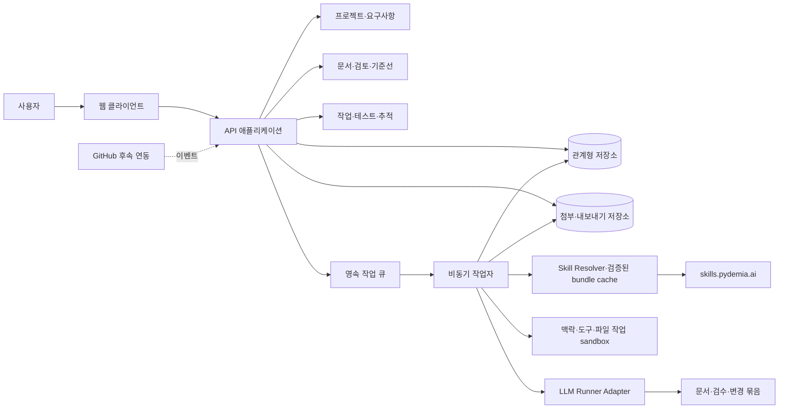

# 설계 방향

상태: 구현 전 기술 제안 · v0.2 · 2026-10-21

이 문서는 앱 자체의 설계 방향이다. 앱이 사용자 프로젝트마다 관리할 System Architecture·Infra·Application·Interface 문서의 템플릿은 [산출물 카탈로그](05-artifact-catalog.md)에 별도로 정의한다. 기술 스택·배포 서비스·예산은 사용자 확정 전이다.

## System Architecture

초기 구조는 웹 클라이언트와 모듈을 나눈 단일 API 애플리케이션으로 제안한다. 문서 버전 확정, 추적 관계, 감사 기록을 같은 트랜잭션으로 처리해 불일치를 줄인다. 스킬 실행·내보내기는 지속성 있는 작업 큐로 처리하고, GitHub·Notion은 연결 adapter로 확장한다.



모듈 사이에는 명시적인 서비스 계약을 두되 초기에는 별도 네트워크 서비스로 분리하지 않는다. 검색과 관계 탐색은 관계형 DB에서 시작한다. 벡터 DB·그래프 DB·Kubernetes 도입 여부는 실제 규모와 검색 요구를 확인한 뒤 판단한다.

| 계층 | 제안 | 선택 이유·검증할 점 |
|---|---|---|
| 웹 | React + TypeScript + Vite, 라우터·서버 상태 라이브러리 | 문서·표·작업 상세의 상태를 분리; 구현 착수 시 호환 버전 고정 |
| API | Python + FastAPI, 검증 스키마, ORM·migration | 문서·AI 처리 확장, OpenAPI 기반 계약 |
| 저장소 | PostgreSQL | revision·관계·기준선·감사 기록의 트랜잭션과 제약 |
| 첨부 | S3 호환 object storage adapter, 개발 시 로컬 저장 | 메타데이터와 바이너리 분리, 원본 해시·권한 유지 |
| 비동기 | DB 작업 테이블 + 별도 worker 프로세스 | 재시작 복구·재시도·상태 조회; 초기 Redis 의존 없음 |
| 문서 | Markdown + 표 + 제한된 Mermaid + 구조화 메타데이터 | 소스·내보내기 용이; HTML과 링크 렌더링 보안 검증 필요 |
| 스킬 | Hub bundle resolver·immutable cache·실행 lock | 원문 규칙·참조·revision을 앱 안/밖 공통으로 사용 |
| LLM 실행 | 공급자/agent runner adapter + 파일·렌더 capability | 문서 작성·수정·검수, 입력·도구·재개·결과 분리 |

이는 추천 조합이며 저장소에 설치하거나 호환성을 검증한 상태는 아니다. FastAPI의 OpenAPI·검증 지원은 [공식 문서](https://fastapi.tiangolo.com/features/), React의 구성 방식은 [공식 문서](https://react.dev/learn)를 참고했다.

후속 프런트엔드 구현 결정: 웹 구조는 React·TypeScript·Vite를 유지한다. 시각 컴포넌트와 토큰은 [ui.pydemia.ai](https://ui.pydemia.ai/)의 고정 소스를 필요한 범위만 편입하고, `ThemeScope`가 UI 모드·light/dark 색·portal 범위를 적용한다. 업무 데이터 상태와 화면 외형 설정을 분리하며 테마 선택은 브라우저 로컬 설정이다. `@pydemia/ui`를 공개 npm 패키지로 설치하지 않는다. 선택 항목·revision·라이선스·검사 범위는 [편입 기록](../implementation/ui-component-integration.md)을 따른다. 웹 정적 산출물에는 엠블럼 favicon을 포함하고 HTML head의 링크와 실제 운영 응답을 릴리즈 검사에서 대조한다.

## Infra

개발 환경은 웹·API·worker와 로컬 DB·첨부 디렉터리로 시작한다. 컨테이너 구성을 제공하되 로컬 실행 경로도 명시한다. 첫 외부 배포는 HTTPS reverse proxy 뒤의 웹/API/worker, 관리형 DB 또는 별도 백업이 검증된 DB, 비공개 파일 저장소로 구성한다. 배포 공급자와 가격은 아직 결정하지 않는다.

| 항목 | 초기 설계 |
|---|---|
| 환경 | 개발·테스트·운영 설정과 저장소 분리, 샘플 데이터를 운영에 넣지 않음 |
| 인증 | 초기 외부 배포부터 로그인 필요; OIDC 기반 세션, 개인 프로젝트를 기본 생성 |
| 세션 | HttpOnly·Secure cookie, 변경 요청 CSRF 보호, 동일 출처 API 기본 |
| 데이터 | DB migration 이력, 첨부 별도 저장, 프로젝트별 접근 검사 |
| 비밀값 | 서버 secret/env, 로그 마스킹, AI·연동 토큰 암호화 또는 secret store 참조 |
| 백업 | DB와 첨부를 함께 백업, 복구 순서·해시 검증, 복구 연습 후 운영 승인 |
| 가시성 | request/job ID, 지연·실패율·큐 적체·AI 사용량, 본문·토큰 기본 비기록 |
| 배포 | 정적 검사·API/DB 통합·E2E → 버전 고정 빌드 → migration → smoke 확인 |
| 롤백 | 앱 rollback과 DB 호환성 구분, 파괴적 migration은 별도 계획 |

RPO/RTO·가용성·데이터 보관 기간·첨부 용량 한도는 운영 범위와 비용을 확인한 뒤 수치로 확정한다. “백업 설정이 있음”과 “복원이 확인됨”을 구분한다.

## Application

### 모듈 경계

| 모듈 | 소유 데이터·행동 |
|---|---|
| identity | 사용자·workspace·membership·프로젝트 권한 |
| projects | 프로젝트·프로필·단계·마일스톤·범위 |
| requirements | 아이디어·요구사항·revision·수용 조건 |
| artifacts | 템플릿·문서·revision·첨부·검토 |
| delivery | 작업·의존성·결함·완료 조건 |
| verification | 테스트 케이스 revision·실행·증빙 |
| traceability | 객체 간 관계·근거 revision·영향 검토 |
| governance | 기준선·결정·변경·예외·감사 이벤트 |
| skill-runtime | SkillBundle·lock·SkillRun·입력/도구/결과·checkpoint·검수 |
| assistance | 요건화·기능 대조·문서 변경·작업 후보·반영 묶음 |
| integrations | 외부 링크·연동 상태·수신 이벤트·반출 작업 |

핵심 업무 규칙은 HTTP handler와 UI에서 분리한다. 저장소·AI·GitHub는 adapter로 주입한다. 문서 편집은 본문을 소유하고 요구사항·테스트 표의 원본 데이터를 별도로 복제해 소유하지 않는다. 정의서로 내보낼 때 해당 구조화 데이터의 snapshot을 조합한다.

### 주요 데이터 구조

```text
workspace ─ membership ─ user
workspace ─ project ─ milestone
project ─ entity_registry(kind, entity_id, display_id)
project ─ idea ─ requirement_candidate / feature_match / change_bundle
project ─ feature ─ feature_evidence
project ─ idea
project ─ requirement ─ requirement_revision
project ─ artifact ─ artifact_revision ─ review_record
project ─ task ─ task_dependency
project ─ test_case ─ test_case_revision
project ─ test_run ─ evidence
project ─ trace_link(source, target, kind, basis_revision)
project ─ impact_review(source_revision, target, status, reason)
project ─ baseline ─ baseline_item(entity_revision)
project ─ decision / change_request / exception / audit_event
project ─ attachment / external_reference / job / ai_proposal
artifact_revision ─ skill_run ─ skill_lock ─ immutable_skill_bundle
```

registry는 관계의 유효한 객체·프로젝트 경계를 검증하기 위한 식별 레이어다. DB 제약 또는 명시적인 typed link 테이블로 참조 무결성을 보장해야 하며, 검증 없는 임의 문자열 ID를 사용하지 않는다. `workspace_id, project_id, entity_id` 경계를 모든 관계에서 확인한다. 표시 ID는 프로젝트 안에서 고유하며 내부 ID는 UUID를 쓴다.

revision은 본문, 부모 revision, 작성자, 생성 시점, 내용 해시를 가지며 확정 후 수정하지 않는다. 검토 요청·확정·철회는 별도 사건으로 기록한다. 초안 저장도 새 revision을 만들되 개인 복구용 임시 저장과 제출 revision의 보관 정책은 구분한다. 기준선 항목은 `latest` 포인터가 아닌 정확한 revision ID를 가진다.

테스트 실행은 케이스 revision·요구사항 기준선·앱 commit(해당 시)·환경·실행자·시작/종료·상태·증빙·출처(수동/CI)를 기록한다. 과거 실패를 새 성공으로 덮어쓰지 않는다. 실패 후 재실행은 새 run이다. CI pipeline 성공만으로 개별 요구사항이 통과했다고 연결하지 않는다.

단일 문서 작업은 workspace 소유 Artifact·SkillRun에 project_id를 비워 둘 수 있다. 위 project 관계도는 프로젝트에 연결된 경우의 구조다. 독립 문서를 나중에 프로젝트에 연결할 때 소유권·revision·관계 경계를 검사한다. 문서 자체는 DB 외부의 일반 파일로도 사용할 수 있다.

### 트랜잭션과 비동기 처리

문서 확정은 권한·기대 revision·검토 조건 확인 → 확정 기록 → 현재 기준 포인터 갱신 → 감사 이벤트 → 영향 검토 작업 예약을 하나의 DB 트랜잭션으로 처리한다. 초기 규모에서 영향 탐색이 작으면 같은 트랜잭션에서 처리할 수 있으며, 비동기로 분리하면 완료 전까지 `영향 분석 중`을 표시하고 gate를 통과시키지 않는다.

job에는 상태, 재시도 수, 실행 lease, heartbeat, 취소 요청, 입력 revision, idempotency key를 둔다. worker가 중단되면 lease 만료 후 재처리한다. 산출물·제안 저장에는 중복 방지 제약을 둔다. 공급자 요청이 취소된 뒤 늦게 응답해도 자동으로 본문에 적용하지 않는다.

### 권한과 보존

개인 모드에서도 모든 객체는 프로젝트와 소유자에 귀속된다. 팀 확장 시 owner·editor·reviewer·viewer 역할을 적용한다. owner는 설정·멤버·예외, editor는 초안·작업, reviewer는 검토·확정, viewer는 조회를 기본으로 하되 owner의 개인 자기 확정을 허용한다. 정확한 조합은 팀 기능 구현 전에 검증한다.

권한은 API·검색·관계 탐색·파일 다운로드·AI 참조·내보내기에서 재확인한다. 비공개 원본을 가져온 문서는 가져오기 대상 프로젝트의 가시성 변화도 확인한다. 첨부 URL은 권한 확인 후 짧은 수명의 다운로드 URL을 발급한다. 외부 URL의 본문 자동 가져오기는 별도 SSRF·출처 정책을 마련하기 전까지 수행하지 않는다.

PostgreSQL RLS는 추가 방어로 검토할 수 있지만 초기 API 권한 검사의 대체물로 사용하지 않는다. 소유자 역할 우회 등 동작은 [공식 문서](https://www.postgresql.org/docs/current/ddl-rowsecurity.html)에 따라 검증한다.

## Interface

MVP API는 프로젝트 범위 REST와 JSON 오류 envelope를 사용한다. 페이지네이션·정렬·필터·타임스탬프 UTC·버전 충돌 정책을 공통으로 정의한다. OpenAPI에서 웹 타입을 생성하고 계약 검사를 수행한다.

| 계약 예시 | 용도·핵심 조건 |
|---|---|
| `POST /api/projects` | 프로필과 프로젝트 생성; 중복 클릭 방지 키 |
| `POST /api/projects/{p}/requirements/{id}/revisions` | 기대 revision과 수용 조건 포함 |
| `POST /api/projects/{p}/artifacts/{id}/revisions` | 기존 revision을 덮어쓰지 않는 저장 |
| `POST /api/projects/{p}/reviews` | 대상 revision·판정·사유 기록 |
| `POST /api/projects/{p}/tasks` | 기준 요구사항·문서 revision·완료 조건 |
| `POST /api/projects/{p}/test-runs` | 케이스 revision·기준선·환경·결과·증빙 |
| `POST /api/projects/{p}/trace-links` | 양쪽 객체·프로젝트·관계 유형 검증 |
| `GET /api/projects/{p}/impacts?source_revision=...` | 경로·영향 검토·누락 상태 |
| `POST /api/projects/{p}/baselines` | 선택 revision 목록 고정과 gate 결과 |
| `POST /api/projects/{p}/ai-proposals` | 참조 manifest·목적·입력 한도, 202 + job ID |
| `POST /api/projects/{p}/ai-proposals/{id}/apply` | 선택 항목·대상 기대 revision; 초안만 생성 |
| `POST /api/projects/{p}/exports` | 기준선·포맷으로 묶음 생성, 202 + job ID |

오류는 `code, message, field_errors, request_id`를 반환한다. 미인증 401, 허용되지 않는 접근은 비노출 정책에 따라 403/404, revision 충돌 409, 입력 오류 422, 예산/호출 제한 429를 구분한다. 충돌 응답은 현재 revision ID를 제공해 병합 UI로 연결하되 권한 없는 본문을 반환하지 않는다.

```json
{
  "expected_revision_id": "rev-old",
  "body_markdown": "## 완료 조건\n요구사항과 실행 결과를 연결한다.",
  "source_refs": [{"entity_id": "req-id", "revision_id": "req-rev-2"}]
}
```

### 스킬 실행·문서 독립 계약

SkillResolver·ContextBuilder·RunnerAdapter·ArtifactsService와 앱 밖 파일·sidecar 교환은 [08 설계](08-skill-runtime-and-portability.md)를 따른다. `POST /api/skill-runs`는 문서 단독 실행을 허용하며 project_id는 선택값이다. 서버는 target 파일 hash·스킬 lock·입력 접근권한을 고정하고 실행 이벤트·산출물·검수·부분 수행 상태를 반환한다. 실행 묶음 반출과 외부 결과 가져오기는 기대 hash로 충돌을 검출한다. source revision 조회·cache 복구·동일 bundle 사용 검사는 LLM 프롬프트와 분리한 deterministic 코드로 수행한다.

### 외부 연동 순서

1. MVP: 사용자 등록 링크·SHA·실행 결과. 수동 등록임을 표시한다.
2. P1 GitHub: repository를 선택한 읽기 권한 App, PR·commit·check/workflow 상태 수신. 문서·요구사항의 원본은 앱에 두고 소스·PR·CI의 원본은 GitHub에 둔다.
3. P1 Notion: 페이지를 선택해 snapshot 가져오기, 원본 URL·수집 시점 보존. 다시 가져올 때 차이를 검토하고 양방향 동기화는 별도 범위로 남긴다.

GitHub webhook은 raw body의 `X-Hub-Signature-256` 검증과 delivery ID 중복 제거, 권한 취소·누락 이벤트 재조회, 늦게 도착한 이벤트 처리를 설계한다. 검증 방식은 [GitHub 공식 문서](https://docs.github.com/en/webhooks/using-webhooks/validating-webhook-deliveries)를 따른다. 읽기 연동만으로 merge·배포를 수행하지 않는다.

AI 공급자는 `generate_proposal(input_manifest, template_version, budget)` → 구조화된 제안·출처·질문을 반환하는 내부 계약을 따른다. 공급자·모델·호스팅 방식은 미정이며 SDK 버전과 데이터 처리 조건은 실제 도입 시 확인한다.
