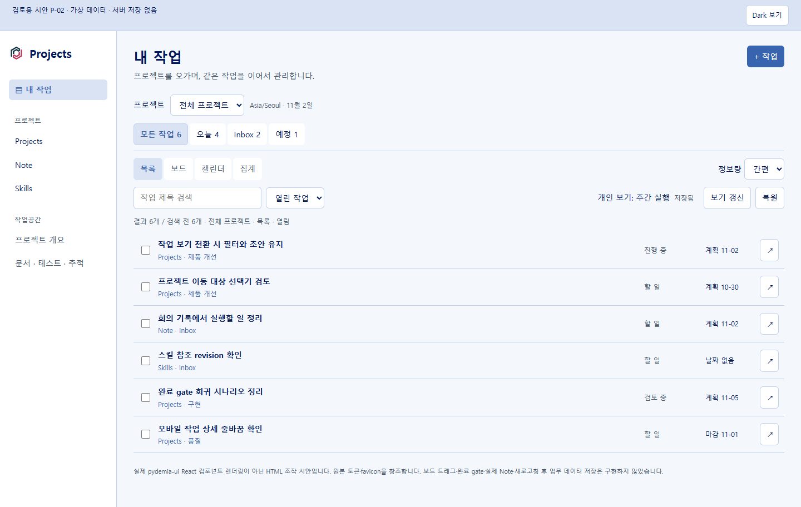
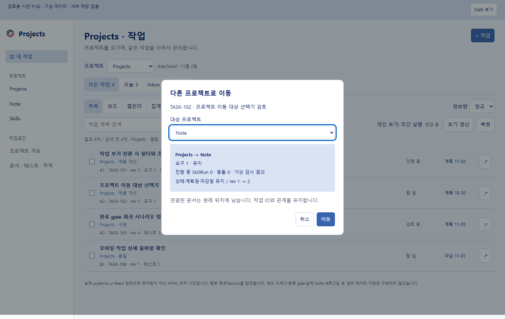

# ClickUp 비교 기반 작업 탐색·프로젝트 간 이동 기획

2026-11-02 · 기획 revision P-02 · 상태: **운영 배포·QA 샘플 생성 완료** · 대상: `projects.pydemia.ai`의 개인 작업공간

[조작 가능한 화면 시안](prototype/task-workspace-v2.html) ·
[스킬 적용·검토 기록](16-clickup-review.md) ·
[스킬 출처·revision·hash](16-clickup-skill-manifest.json)

## 결정할 문제와 범위

사용자 요청은 (1) 작업을 프로젝트 간 옮길 수 없고 (2) 작업이 첫 화면에서 잘
보이지 않아 간단한 관리가 어렵고 (3) 작업 보기 모드도 자연스럽게 전환해야
한다는 것이다. 기존 [작업공간 벤치마크](12-task-workspace-benchmark.md),
[상호작용 재분석](13-task-interaction-rea.md), [현재 실행 goal](../implementation/goal.md)을
승계한다. 이미 구현한 상태 열 이동·순서, 간편/정교 보기, 오늘 계획, 개인 저장
보기를 새 기능으로 다시 계산하지 않는다. 아래의 화면·API·순서는 제안이며 앱
구현이나 운영 반영의 완료 판정이 아니다.

**제품 방향:** 모든 프로젝트의 작업을 한곳에서 찾고 처리한다. 작업은 하나의
현재 소속 프로젝트를 가지며, `이동`은 그 소속을 바꾼다. 여러 화면에 보인다는
이유로 작업을 복제하지 않는다. 다른 프로젝트에서 같은 작업을 함께 관리하는
다중 소속은 이번 이동과 다른 기능으로 남긴다.

## 조사 근거와 관찰 경계

| 근거 | 확인한 사실 | 수준·한계 |
|---|---|---|
| Projects 운영 브라우저, 2026-11-01 | 첫 진입은 저장 순서 첫 프로젝트의 개요다. 그 프로젝트의 작업 화면은 기본 `오늘` 0건이어도 열린 작업이 존재했다. 정교 목록에서 현황 카드·빠른 입력·필터·저장 보기 아래로 실제 작업 행이 첫 화면 밖으로 밀렸다. 작업 편집에는 자유 입력 `목록·영역`은 있지만 소속 프로젝트 변경은 없다. | 실제 Microsoft Entra 로그인 후 읽기·화면 전환 관찰. 현재 계정·데스크톱 폭의 운영 상태이며 전체 계정·모바일 성능으로 일반화하지 않는다. 작업 내용은 문서에 복사하지 않는다. |
| Projects 현재 코드 | `TaskWorkspace.tsx`는 현재 프로젝트의 `items`만 받는다. `App.tsx`의 작업 탐색도 선택 프로젝트 아래에 있다. `GET /api/projects/{project_id}/items`와 개인 `task_views`는 프로젝트 범위다. `POST /api/items/{id}/move`는 **같은 프로젝트 안의 상태/보드 순서 이동**이다. 간편 `오늘`은 실행 예정일이 오늘과 같거나 마감이 지난 작업만 포함하므로, 실행 예정일만 지난 열린 작업은 `Inbox`가 아닌 경우 간편 보기 셋 어디에도 나타나지 않을 수 있다. `changeMode`는 보기 값을 `today` 또는 `list`로 바꾸고 저장 보기 연결을 해제한다. 탭/모바일 보기 선택은 선택 작업과 저장 보기 연결을 해제한다. | 저장소 관찰. 운영 바이너리와 현재 커밋의 동일성은 별도 확인하지 않았다. |
| ClickUp 로그인 브라우저, 2026-11-01 | 목록을 열자 작업 행·상태 그룹·상단 보기 전환·검색이 같은 화면에 보였다. 작업 상세 상단에는 현재 위치 경로, `Move task`와 `Add to another List`가 별개였다. `Move task`는 검색/탐색 가능한 위치 선택기를 열었다. 전역 `My Work` 패널은 Today·Overdue·Next·Unscheduled·Done을 모아 보여 주었다. | 사용자 계정의 ClickUp 4.0 데스크톱 화면을 **읽기만** 관찰. 실제 이동은 실행하지 않았고 요금제·모바일·다른 권한은 미확인이다. |
| [ClickUp 이동 안내](https://help.clickup.com/hc/en-us/articles/6329600534935-Move-tasks-between-Lists), [다중 목록](https://help.clickup.com/hc/en-us/articles/6309958824727-Tasks-in-Multiple-Lists) | Move는 원래 List에서 제거하고 대상 List로 옮긴다. Add는 원래 위치를 유지하며 추가한다. 상세/행/일괄 도구에서 이동할 수 있고, 대상 상태 체계가 다르면 상태 매핑을 묻는다. | ClickUp 공식 도움말. Projects는 List/Space 계층이나 다중 소속을 그대로 도입하지 않는다. |
| [ClickUp All Tasks](https://help.clickup.com/hc/en-us/articles/6309783246103-View-all-your-tasks), [My Tasks](https://help.clickup.com/hc/en-us/articles/31007956275863-My-Tasks), [검색](https://help.clickup.com/hc/en-us/articles/6311703331479-Search-your-Workspace), [보기 조작](https://help.clickup.com/hc/en-us/articles/35368731425175-The-views-control-bar), [Task views](https://help.clickup.com/hc/en-us/articles/6310172583831-Use-Task-views) | 소속 위치별 보기와 전역 작업 보기, 전역 검색, 보기 안의 그룹/정렬/필터/검색을 분리한다. 같은 위치의 작업을 List·Board·Calendar 등으로 볼 수 있다. | 공식 문서. 실제 계정에서 모든 메뉴·권한 조합을 재현한 것은 아니다. |
| [이전 REA 기록](13-task-interaction-rea.md) | 2026-10-21 ClickUp 보드의 드래그/일괄 선택을 실제 조작했고 공개 JS 청크에서 낙관적 이동·오류 복구 경로를 정적으로 분석했다. | **과거 조사 재사용**. 이번에 ClickUp JS를 새로 분석하거나 서버 저장 알고리즘을 확인하지 않았다. |
| [Note 연계 계약](../implementation/note-document-handoff.md)과 로컬 Note 소스 | Note는 실제로 `GET /api/pages`, `GET /api/pages/:id`, `PUT /api/pages/:id`, revision 목록 경로를 갖는다. | 코드 경로 확인일 뿐 Projects→Note 인증 위임·접근 권한·운영 API 호출 성공의 증거는 아니다. |

## 제품에 적용할 원칙

### ClickUp에서 가져올 구조와 Projects에 맞춘 선택

2026-11-02에 공식 [보기 도구막대](https://help.clickup.com/hc/en-us/articles/35368731425175-The-views-control-bar),
[Task views](https://help.clickup.com/hc/en-us/articles/6310172583831-Use-Task-views),
[작업 이동](https://help.clickup.com/hc/en-us/articles/6329600534935-Move-tasks-between-Lists)을
다시 확인했다. 아래의 상태 보존·초안·데이터 이관 규칙은 Projects의 설계 결정이며
ClickUp 내부 구현을 복원했다는 주장이 아니다.

| ClickUp에서 관찰·확인한 원리 | Projects 적용 | 채택 이유·범위 |
|---|---|---|
| 전역 My Work와 위치별 작업 보기를 제공 | 고정 `내 작업`과 프로젝트 작업 화면 | 프로젝트를 먼저 찾아 들어가야 작업이 보이는 비용을 줄임. 담당자·팀 협업 모델은 추가하지 않음 |
| 작업 목록과 보기 도구를 한 화면에 배치 | 현황 카드를 개요/집계로 보내고 행을 첫 화면에 배치 | 작업 조회·추가·완료가 첫 흐름이 되게 함 |
| 같은 위치를 List/Board/Calendar 등으로 표시 | 작업 집합과 표시 방식·밀도를 독립 관리 | 간편→정교가 오늘→전체 초기화로 이어지는 현재 동작 해소. 전환 간 모든 설정 보존은 Projects 추천 계약 |
| 그룹·정렬·필터·검색과 표시 필드 설정을 구분 | 공통 필터 + 표시별 정렬/필드 + 명시 저장 보기 | 사용 중인 조건이 사라지거나 수동 보드 순서가 덮어써지는 것을 방지 |
| Move와 Add to another List를 구별 | 단일 소속의 `다른 프로젝트로 이동`부터 제공 | 복제/다중 소속과 이동의 의미를 섞지 않음. 현재 단계에서 새 계층을 늘리지 않음 |
| 행 메뉴·상세·일괄 도구가 같은 이동으로 연결 | 세 진입점이 동일 preview/commit을 공유 | 마우스·키보드·터치에서 같은 결과와 오류 규칙 제공 |
| 서로 다른 상태·사용자 필드는 이동 시 처리 선택 | 현재 공통 상태/GTD/ABC를 유지 | 지금 없는 프로젝트별 상태/사용자 필드 체계를 이번 기능에 끼워 넣지 않음. 도입될 때 명시 매핑을 확장 |

### 적용 원칙

1. **작업을 먼저 보여 준다.** 화면 첫 흐름은 `작업 목록 → 선택 작업의 상세`다.
   프로젝트 설명·집계·보기 설정은 작업을 가리지 않는 위치로 옮긴다.
2. **전체와 현재 프로젝트를 명시한다.** `내 작업`은 소유한 프로젝트 전체를
   조회하고 `프로젝트 > 작업`은 현재 프로젝트로 제한한다. 두 화면의 같은
   작업은 동일 ID·revision을 사용한다. 현재의 첫 프로젝트 자동 선택 결정
   (APP-REQ-037)은 유지하고, 전역 `내 작업`을 별도 고정 탐색 항목으로 둔다.
3. **범위·표현·밀도를 독립적으로 바꾼다.** `오늘/Inbox/예정/모든 작업`은
   어떤 작업을 볼지, `목록/보드/캘린더/집계`는 어떻게 볼지, `간편/정교`는
   얼마나 많은 정보를 보여 줄지 결정한다. 한 축을 바꿔도 다른 축과 작업
   선택·검색·저장 보기를 조용히 초기화하지 않는다.
4. **오늘 0건은 전체 0건이 아니다.** 빈 오늘 화면에서 열린 다른 작업의 건수와
   `모든 작업 보기`·`Inbox 보기`를 바로 제공한다. 실행 예정일만 지난 열린
   작업은 `미처리 계획`으로 오늘 아래에 드러내는 변경을 제안한다. 날짜를
   자동 연기하지 않고 원래 `planned_date`와 `due_date`를 보존한다.
5. **이동·상태 변경·다른 프로젝트에서 참조를 구별한다.** `목록·영역`은 현재
   프로젝트 안의 문자열 분류이며 프로젝트 이동이 아니다. 상태 보드 드래그도
   프로젝트 이동이 아니다. 메뉴와 대화상자에서 현재/대상 프로젝트를 표시한다.
6. **근거를 보존한다.** 이동한 작업의 ID·revision 이력·완료 조건·관계·과거
   SkillRun·기준선 참조를 잃지 않는다. 이 조건을 구현하지 못한 경우 해당
   작업은 영향 사유를 보여 주고 이동을 거부한다. 자동 복사/연결 해제는 하지 않는다.

## 정보 구조와 화면

```text
작업공간
├─ 내 작업 (전역 고정 진입)
│  ├─ 모든 작업  ← 첫 화면은 열린 작업 목록
│  ├─ 오늘       ← 전 프로젝트 planned/due 규칙
│  ├─ Inbox      ← 전 프로젝트의 각 Inbox 작업
│  └─ 예정
├─ 프로젝트 목록 (기존 첫 프로젝트 자동 선택·순서 보존)
└─ 프로젝트
   ├─ 개요·기획·임시 문서·테스트·추적·스킬 작업 (기존)
   └─ 작업       ← 해당 프로젝트의 목록·보드·캘린더·집계
```

### 전역 `내 작업`

- 왼쪽 탐색 상단에 `내 작업`을 프로젝트 목록과 동급의 독립 항목으로 둔다.
  `오늘`, `모든 작업` 등의 건수는 실제 접근 가능한 열린 작업만 집계한다.
  프로젝트를 바꿔도 이 진입점은 보인다.
- 기본은 **열린 작업 목록**이다. 상단 한 줄에 범위/보기, 검색, `+ 작업`을 둔다.
  그 아래 필터 칩은 `프로젝트`, `상태`, `계획/마감`, `유형`부터 시작한다.
  프로젝트별 그룹과 상태별 그룹은 선택 사항이다. 한 작업이 여러 날짜 조건에
  맞더라도 같은 보기에서는 한 행만 보인다.
- 행의 기본 정보는 완료/선택, 제목, 소속 프로젝트, 상태, 계획일/마감일,
  `…`다. 목록·ABC/GTD 등의 추가 필드는 보기 설정에서 펼친다. 제목을 누르면
  목록 문맥을 유지한 채 상세를 연다. 프로젝트 이름은 해당 프로젝트 작업
  화면으로 이동하고, 옆의 `… > 다른 프로젝트로 이동`은 소속을 변경한다.
- 제목 검색은 전역 범위와 현재 프로젝트 범위를 구별한다. 검색 결과에는
  프로젝트와 상태를 항상 붙이고, 권한 없는 프로젝트의 제목·건수는 제외한다.
  저장된 보기는 기존처럼 개인 범위이며 전역 보기 설정은 프로젝트 보기와
  다른 소유 범위로 저장한다.

### 프로젝트 `작업` 화면 재배치

- 데스크톱 첫 화면에는 제목/보기 탭/간단 검색·필터와 **첫 작업 행**이
  보이도록 구성한다. 현황 3개 카드는 개요/집계로 옮기거나 접힌 한 줄
  요약으로 표시한다. 빠른 추가는 목록 맨 위의 한 줄 입력으로 둔다. GTD/ABC
  조건과 저장 보기 편집은 `필터`/`보기 설정` 안에서 펼친다.
- 목록의 행은 정렬·구분선으로 또렷하게 읽고, 별도 카드 테두리를 반복하지
  않는다. 필터 막대는 하나의 조작 영역, 작업 행은 비교 가능한 동급 항목,
  상세 패널은 별도의 편집 범위로 보이게 한다. 선택/오류/초점은 색 외의
  텍스트·아이콘·윤곽으로도 구별한다. 21개 UI 모드·light/dark의 기존 토큰과
  `ui.pydemia.ai`에서 편입된 `AppShell`, `Navigation`, `Tabs`, `SearchInput`,
  `DataList`, `DropdownMenu`, `Dialog`, `Popover`, `Empty`를 우선 조합한다.
  사용 source와 hash는 [공통 UI 편입 기록](../implementation/ui-component-integration.md)에
  연결하고 새로운 변형만 실제 registry에서 확인한다.
- 보드/캘린더/집계는 같은 필터 결과의 보기다. 보드의 현재 상태·순서 이동과
  완료 gate는 유지한다. 2026-11-02 사용자 피드백을 반영해 전역에서도 네
  표시 방식을 모두 제공하며 프로젝트 선택·정보 밀도를 전환 조건으로 삼지 않는다.
- 모바일에서는 기존 `오늘·Inbox·작업·더보기` 하단 탐색을 유지하고 상단에
  `전체 프로젝트/현재 프로젝트` 범위 선택을 둔다. 작업 목록을 먼저 보이고
  상세는 전체 화면, 필터·이동 대상은 sheet로 연다. 드래그 없이도 모든 이동을
  수행하며, 긴 이름·키보드·safe area·뒤로 복귀를 확인한다.

### 보기 모드의 자연스러운 전환

현재 `taskMode=simple|complex`와 `taskView=today|inbox|upcoming|list|board|calendar|insights`는
범위와 표현을 한 값에 묶는다. 저장 보기의 `mode`/`view`도 이 조합을 강제한다.
전환할 때 `today`↔`list`로 강제 이동하고 `savedView`/선택 작업을 지우는 동작을
바꾼다. 새 보기 상태는 다음 세 축으로 정의한다.

| 축 | 값과 의미 | 전환 시 유지할 것 |
|---|---|---|
| 작업 범위 | `모든 작업`, `오늘`, `Inbox`, `예정`과 전역/현재 프로젝트 선택 | 검색어·다른 필터·선택 작업. 양쪽 범위에 속하는 작업의 ID·revision은 동일 |
| 표시 방식 | `목록`, `보드`, `캘린더`, `집계` | 범위·필터·선택 작업. 표시 불가능한 날짜 없는 작업의 존재도 안내 |
| 정보 밀도 | `보기 모드: 간단 / 상세` | 범위·표시 방식·작업 선택. 간단은 주요 행동/필드, 상세는 추가 필드/일괄 조작을 펼침. 내부 simple/complex 값과 호환 |

- 화면 상단의 프로젝트 선택 아래에 **범위 탭**, 그다음 줄에 **표시 방식과
  밀도 전환**을 둔다. 서로 다른 축을 한 선택 메뉴에 섞지 않는다.
  `보기 모드 · 간단/상세`는 제목·선택 배경을 갖춘 정보량
  선택기다. 모바일은 하단의 오늘/Inbox/작업 진입을 유지하고, 현재 범위와
  표시 방식을 상단의 짧은 선택기로 보여 준다. 어떤 화면에서도 현재
  프로젝트와 적용 필터, 결과 건수를 읽을 수 있다.
- `오늘 · 간편 목록 → 오늘 · 정교 목록`은 같은 작업 행·검색 결과를 유지하며
  메타데이터와 일괄 도구만 추가한다. 이어 `보드`를 누르면 같은 필터 집합을
  상태 열에 그린다. GTD/ABC 자동 정렬과 보드 수동 순서는 **표시 순서만**
  달라질 수 있음을 알리고 저장된 보드 순서를 덮어쓰지 않는다.
- `보드 → 캘린더`는 현재 범위를 유지한다. 날짜 없는 작업은 `날짜 없음`
  목록에 남겨 작업이 사라진 것처럼 보이지 않게 한다. `집계`는 같은 필터의
  현재 snapshot임을 표시한다. 목록·보드·캘린더·집계 사이에서 상태, 일정,
  GTD/ABC 값과 완료 gate는 보기 변경만으로 수정되지 않는다.
- 열린 작업 상세는 보기 전환 후에도 유지한다. 선택 작업이 새 범위 밖이면
  상세에 `현재 보기의 조건 밖`을 표시하고 원래 작업으로 돌아가는 경로를
  제공한다. 편집 중인 초안/일괄 입력은 전환만으로 폐기하지 않는다.
  모바일 뒤로 가기는 이전 보기와 목록 위치로 돌아간다.
- 저장된 보기를 연 상태에서 표시 방식이나 밀도를 바꾸면 연결을 지우지
  않고 `변경 중`으로 표시한다. `보기 갱신` 또는 `새 보기로 저장`은 명시적인
  행동이다. 다른 저장 보기를 선택하면 그 보기의 범위/표현/필터가 적용됨을
  이름과 선택 상태로 보여 준다. 기존 개인 보기의 기본값·소유권은 유지한다.
- 브라우저 URL에는 범위·표시 방식·밀도·선택 작업·저장 보기 ID를 독립적으로
  표현하고 뒤로/앞으로에서 복원한다. 기존 `taskMode`/`taskView` 링크와
  저장 보기는 의미를 바꾸지 않고 새 값으로 변환한다. 예를 들어 예전
  `simple:today`는 `오늘+목록+간편`, `complex:board`는 `모든 작업+보드+정교`다.
  검색/필터가 URL과 저장 보기 중 어디에 속하는지도 명시해 새로고침 때
  결과가 달라지지 않게 한다.
- 전역에서도 목록·보드·캘린더·집계를 간단/상세 양쪽에서 지원한다.
  전체 프로젝트로 범위를 바꿔도 표시 방식을 목록으로 강제하지 않는다.
  전역 보드는 프로젝트명을 표시하고 자동 정렬하며, 프로젝트별 수동 순서는
  해당 프로젝트에서 관리한다. 집계형 보기는 서버 페이지 전체를 조회하고
  조회 중·부분 실패는 불완전한 결과임을 표시한다.
- 전환은 작업 목록 전체를 가리는 로딩 화면 없이 기존 결과를 유지하며
  새 결과가 준비되면 바꾼다. 전환 후 키보드 초점은 선택한 탭/선택기에
  남기고, 새 레이아웃에서 해당 작업을 찾을 수 있게 한다. 모션 감소 설정에는
  장식성 이동을 적용하지 않는다.

### 상태별 문구

| 상태 | 화면 행동 |
|---|---|
| 오늘 예정 0건, 다른 열린 작업 있음 | `오늘 계획한 작업은 없습니다`와 다른 열린 작업 건수, `모든 작업`/`Inbox` 바로가기. 지난 실행 예정일의 열린 작업이 있으면 별도 `미처리 계획 n건` 행을 먼저 표시 |
| 접근 가능한 작업 0건 | 짧은 한 줄 설명과 `+ 작업`만 표시; 복잡한 보기 설정은 접음 |
| 검색/필터 결과 0건 | 적용된 조건을 보여 주고 조건 초기화/다른 범위로 이동 제공 |
| 로딩/오류 | 이전 목록을 사용할 수 있으면 유지하고 재시도 제공; 빈 결과와 오류를 혼동하지 않음 |
| 이동 후 현재 필터에서 제외 | 성공 안내에 대상 프로젝트와 `이동한 작업 열기`·`되돌리기` 제공 |

## 기능·상태의 상세 계약

### 기본값·범위·날짜의 명확한 정의

사용자 요구는 작업 탐색·이동·자연스러운 전환이다. 다음 기본값과 날짜 정책은
그 요구를 구현 가능한 수준으로 풀어 쓴 **추천안**이며 사용자 확정과 구분한다.

| 항목 | 추천 동작 |
|---|---|
| 첫 진입 | 명시 URL 프로젝트를 우선하고, 없으면 계정별 마지막 접근 가능 프로젝트를 복원한다. 기억이 없거나 접근 불가하면 저장 순서의 첫 프로젝트로 진입한다. 명시 전체 작업·프로젝트 목록은 그대로 연다. `전체 작업` 첫 방문은 `전체 프로젝트·모든 작업·목록·간단·열림`. 이후 진입점별 마지막 유효 보기를 복원한다. 프로젝트 작업 기본도 `모든 작업`이며 명시 저장 보기를 우선한다. |
| 소속 범위 | `전체 프로젝트` 또는 특정 프로젝트 1개. 프로젝트 필터로 여러 개를 선택한 경우 교집합을 사용한다. 프로젝트 화면에서는 현재 프로젝트가 고정 조건이며 필터를 풀어도 전역으로 확장하지 않는다. |
| 모든 작업 | 날짜 조건 없음. 상태 필터는 별개이며 첫 기본은 `열림`이다. 완료·취소도 상태 필터를 바꾸면 찾을 수 있다. `모든 작업`을 모든 상태라는 뜻으로 사용하지 않는다. |
| 오늘 | 열린 작업 중 `planned_date = 오늘` 또는 `due_date ≤ 오늘` 또는 `planned_date < 오늘`. 날짜는 사용자에게 표시하는 시간대의 달력 날짜로 판정한다. 최초 정책은 Asia/Seoul이며 화면에 기준을 표시하고 API에도 같은 기준일을 전달한다. 자정을 지나면 목록·건수를 함께 갱신한다. |
| 오늘의 그룹 | `마감 지남(due < 오늘)` → `오늘 계획/마감(planned = 오늘 또는 due = 오늘)` → `미처리 계획(planned < 오늘)` 우선순위로 한 곳에만 배치한다. 마감 지남에는 원래 계획일도 표시한다. 보기만 열어 날짜를 변경하지 않는다. |
| Inbox | 열린 작업 중 기존 `list_name = Inbox`. 날짜 유무와 독립적이므로 오늘과 겹칠 수 있다. 일정 없는 모든 작업이라는 새 의미로 바꾸지 않는다. |
| 예정 | 열린 작업 중 `planned > 오늘` 또는 `planned가 없고 due > 오늘`. 오늘/Inbox/예정은 전체 작업의 배타적 분할이 아니다. 모든 작업이 최종 탐색 경로다. |
| 닫힌 작업 필터 | 오늘/Inbox/예정은 열린 작업용이므로 완료·취소 필터를 고르면 `완료 작업은 모든 작업에서 볼 수 있습니다`와 `모든 작업으로 전환`을 먼저 제시한다. 자동 전환·필터 해제는 하지 않는다. |
| 건수 | 범위 탭 건수는 현재 프로젝트 조건과 권한·열림 조건의 기준 건수다. 검색/추가 필터 뒤에는 별도로 `결과 n개 / 검색 전 m개`를 표시하며 m은 현재 범위·상태 조건을 적용한 값이다. 완료 포함 시에도 탭의 열린 건수와 결과의 전체 상태 건수를 혼동하지 않게 상태명을 표시한다. 서버가 계산한 전체 결과이며 현재 페이지 행 수와 구별한다. |

### 표시 조합과 전환 계약

| 소속 범위 | 목록 | 보드 | 캘린더 | 집계 |
|---|---|---|---|---|
| 현재 프로젝트 | 모든 작업·오늘·Inbox·예정 지원 | 같은 4개 범위, 상태 열 고정 | 같은 4개 범위, 날짜 없음 영역 포함 | 같은 4개 범위, 현재 분포 |
| 전체 프로젝트 | 같은 4개 범위 지원 | 프로젝트명 표시·자동 정렬·상태 변경 | 같은 날짜 계약·날짜 없음 영역 | 전체 조회한 같은 필터 결과의 분포 |

전역·프로젝트의 모든 표시 방식은 간단/상세와 독립적으로 사용 가능하다.
프로젝트 선택은 URL의 `project`를 기준으로 하고 메뉴·목록·모바일 하단 탐색과
새로고침이 선택을 지우지 않는다. 명시적인 `전체 작업`만 전역으로 전환하며,
프로젝트 메뉴로 돌아오면 마지막 접근 가능 프로젝트를 선택한다.
마지막 선택은 계정별로 구분하고 로그아웃 시 지우며 접근 권한을 다시 확인한다.

목록 정렬과 보드 정렬은 표시별 설정이다. `GTD 목록 → 수동 보드 → 목록`에서
목록의 GTD가 돌아온다. 자동 정렬 보드에서는 상태 변경만 가능하고 열 안 수동
순서 조작은 `수동 순서로 전환`을 거쳐야 한다. 보기 전환은 저장 API를 호출하지 않는다.

캘린더 기본 배치 기준은 `실행 예정일, 없으면 마감일`이다. 별도 `마감일 기준`
선택을 제공하고 두 값이 있어도 한 작업은 날짜 한 칸에만 놓는다. 마감 배지는
함께 표시한다. 현재 월 밖의 작업과 날짜 없는 작업을 각각 집계하고 `해당 날짜로
이동`/`날짜 없음` 목록에서 연다. `필터 결과 8개 = 현재 기간 4개 + 다른 기간
3개 + 날짜 없음 1개`처럼 누락을 설명한다. 일정 드래그는 기존 P2로 남기며
이번 보기 전환과 함께 도입하지 않는다. 집계는 현재 필터의 상태 분포이고
기간별 성과·누적 이력이라는 이름을 붙이지 않는다.

### 상태 저장·복원과 초안

새 URL의 예시는 다음과 같다. 정확한 route 이름은 구현 단계에서 기존
`view=tasks`와 호환되게 확정한다. URL은 식별·보기 상태만 포함한다.

```text
?view=tasks&project=A&taskScope=today&taskLayout=board&taskDensity=compact
 &taskStatus=open&taskQuery=검색어&savedView=V&item=T
```

적용 순서는 `기존 URL 변환 → 명시 저장 보기 로드 → 명시 URL 필드 덮어쓰기 →
빠진 필드만 진입점의 마지막 상태/기본값으로 채우기`다. 유효하지 않은 값은
해당 필드만 복구하고 안내한다. 접근 불가능한 savedView/작업 ID는 존재·제목을
누설하지 않는 안내와 접근 가능한 목록으로 처리한다. 서버 지연 중 오래된
savedView 응답이 새 URL 상태를 덮어쓰지 않도록 요청 세대/취소를 사용한다.

| 상태 | 보관·복원 계약 |
|---|---|
| 영속 개인 저장 보기 | schema version, 소유자, 전역/프로젝트 범위, 작업 범위, 표시, 밀도, 필터, 표시별 정렬·필드, 캘린더 배치 기준을 저장한다. 같은 진입점의 기본 보기 하나를 보장한다. 보기 revision으로 갱신 충돌을 알린다. |
| 현재 보기 | URL의 범위·표시·밀도·검색·상태·선택 작업이 새로고침/뒤로/앞으로의 기준이다. 기본 저장 보기 응답이 명시 URL을 덮어쓰지 않는다. |
| 저장 보기의 변경분 | 원래 보기 ID/revision과 현재 설정을 비교해 `변경 중` 표시. `보기 갱신`, `새 보기로 저장`, `원래 보기로 복원`을 제공한다. 다른 보기 선택은 표시 설정에만 적용하고 작업 초안을 버리지 않는다. |
| 초안 | 작업 ID·기대 revision·사용자 기준으로 session draft를 분리한다. URL/저장 보기에는 본문·인증 정보를 넣지 않는다. 보기 전환·뒤로 가기·일시적 상세 닫힘에서 보존한다. 계정 전환/로그아웃 시 개인 초안·선택·조회 cache를 제거한다. |
| 미저장 작업의 이동 | `먼저 저장`, `저장한 버전으로 이동`, `취소`를 명시한다. 두 번째를 택해도 로컬 초안은 유지하고 대상의 최신 revision과 재대조한다. 초안을 묵시적으로 서버에 저장하지 않는다. |
| 다중 선택 | 같은 소속 범위 안에서 표시 전환 시 유지한다. 필터 밖 선택은 `선택 n개·현재 결과 밖 m개`로 알리고 실행 전 전체 대상을 펼쳐 본다. 소속 범위가 바뀌면 이전 선택 묶음을 보관하되 새 화면의 실행 대상으로 자동 승계하지 않는다. |
| 스크롤·초점 | 진입점+표시별 scroll anchor(작업 ID/날짜)를 기억한다. 전환 중 탭/선택기 초점을 유지하고 상세를 닫으면 원래 작업 행으로 돌아간다. 작업이 없으면 목록 제목으로 복귀한다. |

현재 `scope=personal`은 접근 범위이므로 전역/프로젝트 데이터 범위와 섞지
않는다. 개인 소유권은 그대로 두고 `scope_type=global|project`를 별도로 둔다.
global에서는 project ID가 없고 project에서는 필수다. 기존 행은 project로
이관하며 기본 보기의 유일성도 소유자+scope_type+프로젝트별로 검사한다.

기존 저장 보기 `simple:today`는 `오늘·목록·간편`으로,
`complex:board`는 `모든 작업·보드·정교`로 읽되 기존 필터/정렬/개인 기본값을
그대로 가져온다. 이전 simple 코드가 무시하던 상태 필터는 열린 작업의 기존
결과를 우선 복원하고 변환 안내를 남긴다. 변환은 재실행해도 중복 보기를 만들지
않으며 legacy URL은 replace navigation으로 정규화한다.

### 작업 생성과 빠른 처리

전역 `+ 작업`은 생성 전에 프로젝트를 명시한다. 직전 프로젝트를 후보로
보여 줄 수 있지만 첫 프로젝트에 조용히 저장하지 않는다. 프로젝트 화면은
현재 프로젝트를 기본으로 쓴다. 오늘에서는 계획일=오늘, Inbox에서는 기존
Inbox 분류·계획일 없음, 예정에서는 내일을 **편집 가능한 기본값**으로 표시한다.
적용 필터 탓에 새 작업이 보이지 않으면 `생성한 작업 열기`와 원인을 제공한다.
간편에서도 완료·계획일 변경·프로젝트 이동을 바로 할 수 있고, 구현 작업의
완료 gate와 실패 안내는 정교 보기와 같다.

### 이동 확인과 저장

1. 작업 행 `… > 다른 프로젝트로 이동`, 작업 상세의 소속 경로에서 `이동`,
   다중 선택 도구막대의 `프로젝트 이동`이 같은 서버 명령을 사용한다.
2. 대상 선택기는 사용자가 접근 가능한 프로젝트를 검색/탐색한다. 현재
   프로젝트와 같은 대상을 고르면 이동하지 않고 현재 위치를 설명한다.
3. 확인 화면에는 `현재 프로젝트 → 대상 프로젝트`, 대상 `목록·영역`, 작업
   상태, 영향받는 관계/테스트/기준선/진행 중 SkillRun 수를 보여 준다. 현재
   상태 체계는 프로젝트마다 같으므로 상태는 유지한다. 상태 체계가 달라지는
   후속 변경에서는 ClickUp처럼 매핑을 명시적으로 받아야 한다.
4. `이동`을 누르면 한 번의 원자적 저장을 수행한다. 성공하면 작업 ID를
   유지하고 현재 목록 문맥과 상세를 유지한다. 소속 조건 밖이면 그 사실을
   표시하고 `대상 프로젝트에서 열기`를 제공한다. `되돌리기`는 또 하나의 조건부 이동이며,
   이동 후 작업이 바뀌었으면 덮어쓰지 않고 최신 상태를 보여 준다.
5. 409 충돌, 대상 접근 불가, 진행 중 SkillRun, 관계/반출 계약 미충족,
   네트워크 실패는 각각 이유를 밝힌다. 실패한 낙관적 화면은 원래 목록으로
   복귀한다. 다중 이동은 전체 사전 검사 후 **전부 이동/전부 거부**한다.

확인 화면의 영향 집계는 서버 preview가 계산한다. preview는 저장 권한이
아니며 commit에서 작업·관계·대상 프로젝트·진행 중 실행을 다시 검사한다.
새 관계나 실행이 생겼으면 새 영향으로 재확인하게 하고, 실패 응답에 다른
소유자의 항목명·건수를 넣지 않는다. 연결된 테스트/요구는 함께 옮기지 않고
원래 프로젝트에 남긴다. 원본 프로젝트 삭제 시에는 남은 교차 관계와 역사
snapshot이 끊어지는지 검사하고 명시적인 처리 전까지 삭제를 거부한다.

저장 요청 시간 초과는 성공 여부 불명 상태다. 같은 operation_id로 결과를
조회/재요청하며 새 이동을 만들지 않는다. 되돌리기도 작업 revision, 원래
프로젝트 접근권한, 관계·실행 gate를 다시 검사한다. 성공 이후 다른 변경이
있으면 자동으로 덮어쓰지 않는다. 프로젝트 간 드래그는 후속 후보이며 최초
출시는 행 메뉴·상세·일괄 도구를 일관된 진입으로 제공한다.

## 데이터·API 설계에서 반드시 해결할 부분

| 현재 결합 | 이동 시 필요한 계약 |
|---|---|
| `items.project_id`, `task_positions` | 단일 작업 ID와 모든 revision을 유지한다. 양쪽 프로젝트 행을 결정적인 순서로 잠그고 기대 revision·소유권을 검사한다. 원래 보드에서 제거해 순서를 다시 매기고 대상 상태 열 끝에 넣는다. 이동 이력은 누가 언제 어디서 옮겼는지 남긴다. |
| `links`의 양 끝이 같은 프로젝트여야 하는 복합 FK, `trace`, `check_task_completion` | 관계를 삭제하지 않고, 같은 소유자의 다른 프로젝트에 있는 작업을 가리키는 링크를 명시적으로 허용하는 관계 모델/조회로 바꾼다. 출처 프로젝트와 상대 프로젝트를 표시한다. 의존·검증 gate는 양 끝 ID로 권한을 확인해 조회한다. 테스트는 원래 위치의 case ID·case revision·target SHA에 맞는 실행 근거를 사용한다. 순환 의존 검사도 소유자 범위의 관련 그래프를 따른다. 타 소유자 연결은 이 단계에서 허용하지 않는다. |
| `baselines`의 프로젝트별 revision 참조 | 이전 기준선은 당시의 프로젝트·작업 revision을 불변 기록으로 읽는다. 현재 작업이 옮겨졌음을 표시하고, 과거 기준선을 현재 프로젝트의 현행 작업으로 잘못 집계하지 않는다. |
| `skill_runs.project_id`, `target_id`, 실행 snapshot | 실행 중/대기 중인 대상 작업은 이동을 거부한다. 완료된 실행은 원래 프로젝트의 실행 이력으로 남기고 이동한 작업에서 원 출처와 함께 읽는다. `review_ready`의 미적용 결과는 이동 후 revision/소속 불일치로 적용을 거부하고 대상 프로젝트에서 재실행하는 경로를 제공한다. 입력 snapshot에만 포함된 작업은 snapshot 원문을 바꾸지 않는다. Hub 원문/revision/hash와 서버 인증 설정은 변경·반출하지 않는다. |
| 프로젝트 ZIP 반출/복구 | 대상 ZIP은 현재 작업·이동 이력을, 출처 ZIP은 기준선/관계에 필요한 과거 snapshot·이동 참조를 보존한다. 두 ZIP을 독립 복구했을 때 외부 참조가 누락되면 누락으로 표시하고 조용히 다른 작업에 연결하지 않는다. 기존 ZIP 버전과 호환 검사를 둔다. |
| 기존 프로젝트 범위 목록·개인 저장 보기 | `GET /api/tasks` 계열의 사용자 범위 페이지 조회/필터/건수를 추가한다. 서버에서 소유 프로젝트로 제한하며 클라이언트가 프로젝트별 목록을 모두 받아 합치지 않는다. 개인 저장 보기는 전역/프로젝트 범위를 구분한다. |

이동 명령의 제안 경로는 `POST /api/items/{id}/transfer`다. 입력은
`expected_revision`, `target_project_id`, 선택적 `target_list_name`,
중복 요청을 판별할 `operation_id`다. 응답은 변경된 프로젝트/작업 revision,
현재 위치, 조건부 되돌리기에 필요한 이동 이력 ID를 포함한다. **상태 열
이동**인 기존 `/move`와 이름·의미를 섞지 않는다. PostgreSQL 트랜잭션에서
검사와 저장을 끝내고, 비밀 설정·인증 파일은 API/로그/ZIP에 넣지 않는다.

소속 변경도 item revision을 증가시키고 `project_transfer` 이벤트에 이전/대상
project ID, 이전/새 revision, 행위자, 시각, operation ID를 남긴다. 기존 revision에는
소속 필드가 없으므로 migration 시점의 현재 소속과 이후 이동 이력으로 재구성할
수 있는 범위만 표시한다. 미기록된 과거 소속을 추정해 확정하지 않는다.

현재 `is_stale`은 단순 revision 차이만으로 관계를 stale로 판정한다. 이동만으로
모든 검토 근거가 낡았다고 표시하지 않으려면 **원문·data·status 동일 + 사이의
변경이 모두 소속 이동뿐임을 입증한 경우**에 한해 내용상 동등한 revision으로
취급한다. 링크의 원래 source/target revision과 검토 이력은 덮어쓰지 않는다.
본문·상태·완료 근거가 바뀐 경우는 기존 stale 규칙대로 재검토한다. 이 예외를
동시성 검사나 SkillRun 결과 적용의 expected_revision 완화에 사용하지 않는다.

| API 제안 | 입력·결과와 주요 조건 |
|---|---|
| `GET /api/tasks` | 소속 범위·작업 범위·상태·검색·정렬·기준일·시간대·cursor를 받고 ID·현재 소속·revision을 반환한다. 권한/필터 적용 후 서버 페이지 조회를 수행한다. 정렬 동률은 ID로 결정하며 페이지 cursor는 필터·정렬 조합과 묶는다. 전체 결과 건수와 페이지 건수를 구분한다. 변경 중인 목록은 snapshot token으로 일관성을 맞추거나 갱신 필요 상태를 알린다. |
| `POST /api/task-transfers/preview` | `{tasks:[{id,expected_revision}], target_project_id, target_list_name?}`. 관련 관계·기준선·실행·보드 영향과 blockers, 입력에 결합된 preview token/관련 revision 지문을 반환한다. 단일/일괄 UI가 공유한다. |
| `POST /api/items/{id}/transfer` | 단일 이동 입력 + preview token. 같은 사용자·operation ID·동일 payload는 같은 결과를 재전달한다. 동일 ID의 다른 payload는 409. 작업·관련 관계·실행의 변경을 재검사하고 한 트랜잭션으로 저장한다. |
| `POST /api/task-transfers` | 일괄 이동. 모든 작업의 expected_revision, preview token, operation ID를 검사하고 하나라도 실패하면 전부 거부한다. 현재 일괄 변경과 같은 최대 100개부터 시작하고 화면에도 한도를 표시한다. |
| `GET /api/task-transfers/by-operation/{operation_id}` | 현재 사용자의 결과만 조회한다. 시간 초과 뒤 성공 여부를 회복하는 경로다. 노출된 ID만으로 다른 사용자의 작업을 찾을 수 없다. |
| `POST /api/task-transfers/{transfer_id}/undo` | 성공 직후 revision과 원래 위치의 권한/관계/실행 상태를 재검사하는 새 원자적 이동이다. 원 이벤트를 삭제하지 않는다. |

이 API 표는 설계 추천이다. 구현 착수 때 endpoint·오류 code·preview 유효기간·
멱등 결과 보관 기간을 실제 API 명세와 함께 확정한다. 기획 단계에서 측정하지
않은 시간값을 성능·보존 보장으로 추가하지 않는다.

## Note 연계 판단

작업 탐색과 프로젝트 이동은 Note의 가용성에 의존하지 않는다. 우선 작업 상세의
`관계·근거`에서 사용자가 선택한 Note 문서 참조를 `Note에서 열기`로 제공한다.
Projects는 `provider`, 문서 ID/URL, 선택 revision/hash와 **작업↔문서 관계 및
SkillRun snapshot**만 소유한다. 본문 편집·승인·검색 제품을 복제하지 않는다.

읽기/검색/작성까지 연계하려면 [Note 연계 명세](../implementation/note-document-handoff.md)의
NOTE-01~08과 실제 Note API의 ID·revision·권한·오류·반출 형식을 먼저
대조한다. 두 서비스가 같은 Entra를 써도 Note의 공유 공간 권한과 Projects의
개인 프로젝트 권한은 같지 않다. 서버 간 신원 위임을 확인하기 전에는 Note
제목/본문을 Projects 전역 검색에 넣거나 임의 URL을 서버에서 가져오지 않는다.
프로젝트 이동 때 기존 문서 참조는 작업 ID에 붙어 유지하고, 대상 프로젝트에서
읽을 권한이 없으면 링크 상태만 표시한다. 실제 Note 호출·운영 연동은 별도 검증이다.

## 화면 구성·컴포넌트 인계

시안 P-02는 가상 데이터의 HTML/JavaScript다. 실제 앱의 React 컴포넌트 실행,
서버 저장·완료 gate·교차 관계 이관·Note 호출을 대신하지 않는다. 기존 팔레트는
`web/src/pydemia-palette.ts`의 승인 블루/네이비 값을 반영하고 공통 tokens.css와
favicon을 참조한다. 기본 모양의 6~12px 모서리는 CSS 근사이며 실제 squircle로
표현하지 않는다. 기존 Glassmorphism·System 기본값과 21개 UI 모드는 제품
구현 시 같은 semantic token으로 유지한다.

| 요구·영역 | 현재 확인한 source/variant → 상태 | 토큰·시각 관계·모바일 예외 |
|---|---|---|
| AC-73·74 탐색/목록 | `web/src/pydemia-ui/app-shell.tsx`, `navigation.tsx`, `data-list.tsx` → 현재 탐색, 선택 행, 빈 목록 | `surface`, `foreground`, `muted`, `border`. 프로젝트 이름과 행을 정렬로 묶고 선택은 면+굵기+현재 상태로 표시한다. 탐색 왼쪽의 장식 색 막대는 추가하지 않는다. 모바일은 기존 BottomNav와 단일 열이다. |
| AC-81 전환 | `tabs.tsx`의 Tabs, `segmented-control.tsx`의 단일 선택, `native-select.tsx` → 활성/비활성/초점 | `accent`, `surface-subtle`, `focus`, `control-height`. 작업 범위와 표시 방식은 제목/행 간격으로 구분하고 밀도는 정보량 선택으로 표시한다. 모바일은 표시 방식과 밀도를 짧은 선택기로 제공한다. |
| AC-82 검색/보기 | `search-input.tsx`, `input.tsx`, `button.tsx`, `badge.tsx` → 검색 중, 변경 중, 갱신 충돌 | 검색과 필터는 같은 결과 집합에 적용되는 한 조작 영역이다. 저장 보기 변경 상태는 작은 텍스트로 표시하고 새 카드/현황 패널을 만들지 않는다. 좁은 화면에서는 보기 저장 도구를 설정 sheet로 옮긴다. |
| AC-75~79 이동 | `dropdown-menu.tsx`, `popover.tsx`, `dialog.tsx`의 desktop wide/mobile fullscreen, 공통 Field/Select → preview loading, blocker, 저장 중, 성공 여부 불명 | 대화상자는 현재 목록과 다른 결정 범위다. `overlay`, `surface`, `danger`, `focus`를 사용한다. 작업 이름·현재→대상·영향·확정 버튼의 순서. 모바일은 전체 화면, 초점 가두기·닫기 복귀·키보드 여백을 보장한다. |
| AC-83 보드/일정/집계 | `kanban.tsx`, 현재 `TaskCalendar`, `bar-list.tsx` → 수동/자동, 날짜 없음, 다른 기간, 현재 snapshot | 상태 열끼리 같은 면/제목 규칙. 날짜 없음 영역은 캘린더와 다른 포함 범위임을 제목으로 표시한다. 모바일 보드는 한 상태 열, 캘린더는 주간 agenda를 사용한다. |
| AC-84 상세/초안 | 현재 RecordEditor, 공통 Dialog/Field → 미저장, 충돌, 현재 조건 밖 | 상세는 목록과 독립된 편집 범위로 한 경계만 둔다. 모바일 상세는 전체 화면이고 닫으면 목록 anchor로 복귀한다. |

source 출처·고정 revision·hash·라이선스·수동 접근성 검수 대기는
[공통 UI 편입 기록](../implementation/ui-component-integration.md)을 따른다.
이번 시안이 위 React component·variant의 접근성 검수를 끝냈다는 뜻은 아니다.

[전역 목록](prototype/screenshots/task-v2-global.png) ·
[보드와 유지된 초안](prototype/screenshots/task-v2-board.png) ·
[캘린더](prototype/screenshots/task-v2-calendar.png) ·
[프로젝트 이동](prototype/screenshots/task-v2-transfer.png) ·
[모바일](prototype/screenshots/task-v2-mobile.png) ·
[모바일 Dark](prototype/screenshots/task-v2-mobile-dark.png)





## 제안 요구와 수용 조건

아래 ID는 2026-11-02 사용자 구현 지시로 [요구사항 기준본](09-requirements.md)에
편입했다. 실제 달성은 [실행 기준표](../implementation/task-workspace-v2-goal.md)의
구현·검증 근거를 따르며 기획서 작성만으로 완료를 판정하지 않는다.

| 제안 ID | 요구 | 수용 조건 |
|---|---|---|
| APP-REQ-038 / AC-73 | 전역 작업 탐색 | 프로젝트를 선택하지 않고도 접근 가능한 열린 작업을 한 목록에서 본다. 각 행에 소속 프로젝트가 보이고, 프로젝트 필터/검색/상세 이동 후에도 같은 ID·revision이다. 타 사용자 작업은 제목·건수·검색에 나타나지 않는다. |
| APP-REQ-039 / AC-74 | 첫 화면의 작업 가시성 | 프로젝트 작업 화면의 데스크톱 첫 화면에서 실제 작업 행 또는 정확한 빈 상태와 한 번의 전체 작업 진입을 볼 수 있다. `오늘 0건`과 `전체 열린 작업 0건`을 구분한다. 같은 조건의 수정 전후 화면을 비교한다. |
| APP-REQ-040 / AC-75 | 단일 작업의 프로젝트 이동 | 간단 작업을 A→B로 옮긴 뒤 A에서는 현행 목록에서 사라지고 B에는 동일 ID·본문·필드·revision 이력이 보인다. 보드 위치/집계/검색/URL이 B를 가리킨다. 상태·GTD·ABC·계획/마감 값은 임의로 바뀌지 않는다. |
| APP-REQ-040 / AC-76 | 연결된 구현 작업 이동 | 요구/의존/테스트/과거 SkillRun/기준선이 있는 작업을 옮겨도 관계·완료 gate·역사 snapshot이 유효하다. 구현 전 안전한 이관이 불가능한 경우 영향 사유를 표시하고 전체 저장을 거부한다. |
| APP-REQ-040 / AC-77 | 이동 실패·동시성 | 오래된 revision, 대상 권한 없음, 실행 중 SkillRun, preview 뒤 관계 추가, 저장 실패에서 양쪽 프로젝트·관계·순서가 함께 불변이다. 중복 요청은 같은 성공 결과를 재전달하며 추가 이동/revision을 만들지 않는다. 성공 여부 불명에서 operation ID 조회로 회복하고 조건부 되돌리기를 확인한다. |
| APP-REQ-041 / AC-78 | 일괄 이동 | 여러 작업은 선택 수·대상·영향을 확인한 후 전부 성공 또는 전부 거부한다. 현재 필터에서 숨은 선택과 각 실패 사유를 표시한다. |
| APP-REQ-042 / AC-79 | 모바일·접근성 | 키보드/터치에서 프로젝트 선택과 이동을 수행한다. 검색·대화상자·상세의 포커스, 뒤로 가기, 320~430 CSS px에서 목록/작업 접근과 가로 넘침을 확인한다. |
| APP-REQ-043 / AC-80 | Note 참조 연계 | 연결된 Note를 열 수 있고 문서 ID·revision/hash가 Projects 관계와 SkillRun 입력에 보존된다. 권한 실패/문서 삭제/Note 불가를 작업 손실이나 성공으로 오인하지 않는다. 실제 API·인증 검증 전에는 미구현/미검증으로 둔다. |
| APP-REQ-044 / AC-81 | 범위·보기·밀도의 독립 전환 | 같은 소속 범위 안의 오늘/Inbox/예정/모든 작업과 목록/보드/캘린더/집계, 간편/정교 사이에서 한 축만 바꾸면 나머지 축·검색·필터·선택 작업이 유지된다. 양쪽 보기에 속하는 작업은 동일 ID·revision이다. 전역/프로젝트 소속 전환은 조합 표의 대체 안내와 진입점별 복원 규칙을 따른다. |
| APP-REQ-044 / AC-82 | 저장 보기·URL 복원 | 저장된 보기를 보며 표시 방식을 바꿔도 조용히 연결이 해제되지 않는다. 변경 중 표시와 명시 저장을 제공한다. 기존 링크/저장 보기, 새로고침, 뒤로/앞으로에서 같은 범위와 작업을 복원한다. |
| APP-REQ-044 / AC-83 | 표현 차이·빈 상태 설명 | 보드 자동/수동 정렬, 캘린더의 날짜 없는 작업, 현재 snapshot 집계, 선택 작업이 새 필터 밖인 상태를 설명한다. 보기 전환만으로 작업 값이나 수동 순서가 변하지 않는다. |
| APP-REQ-044 / AC-84 | 전환 접근성·초안 보존 | 데스크톱/모바일에서 키보드·터치로 보기를 바꾸고 초점/스크롤 문맥을 유지한다. 작업 상세와 미저장 초안·일괄 입력이 전환 때문에 사라지지 않는다. 모션 감소 설정도 확인한다. |

## 실행 순서와 검증 경계

1. **작업 가시성과 보기 상태:** 프로젝트 작업 화면의 첫 화면 재배치,
   오늘 빈 상태, 범위/표시 방식/밀도의 독립 전환과 기존 링크·저장 보기
   호환성을 구현한다. 이어 전역 `내 작업` 목록/서버 조회에 같은 상태 모델을
   적용한다. 운영과 동일한 데이터 조건에서
   첫 작업을 찾는 경로와 스크롤/클릭 수를 수정 전후로 측정한다. 목표 수치는
   기준선 측정 뒤 정한다.
2. **단일 이동:** 관계·기준선·SkillRun·ZIP의 이관 규칙과 PostgreSQL
   migration을 먼저 구현하고 단일 이동 API/미리보기/되돌리기를 연결한다.
   일반 작업뿐 아니라 연결된 구현 작업을 통과시켜야 완료로 판정한다.
3. **일괄·모바일:** 원자적 다중 이동, 작은 화면의 대상 sheet, 키보드/터치
   조작과 오류 복구를 검증한다.
4. **Note 참조:** 실제 Note 계약/권한 대조 뒤 읽기 링크부터 연결한다.
   문서 본체 이관과 API 쓰기는 별도 범위로 둔다.

검증은 저장소 `AGENTS.md`의 PostgreSQL 전용 schema 통합 검사와 서버/웹
명령을 사용한다. 실제 Projects 브라우저에서 목록·이동·새로고침·뒤로 가기와
권한/충돌을 확인한다. ClickUp 관찰, mock, 로컬 앱, 운영 Projects, 실제 Note
호출, 실제 LLM 검증은 각각 따로 기록한다. favicon은 기존 승인 엠블럼의
경로·light/dark·fallback·빌드/HTTP/탭 표시를 수용 조건에 포함하며, 이번
기획만으로 검증 완료로 표시하지 않는다.
