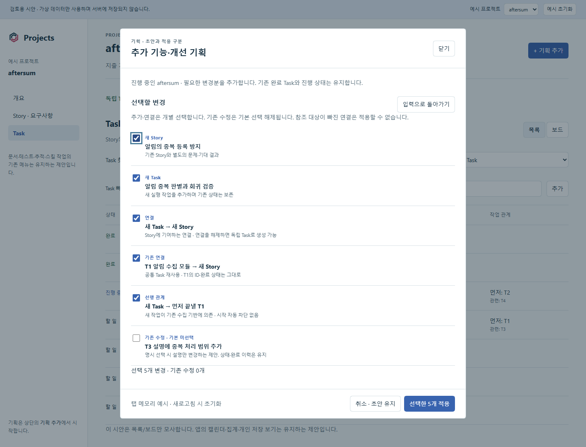

# 기획 기능과 Story·Task 작업 관리 개선안

2026-11-09 · 상태: 사용자 goal에 따라 설계·구현·검증·운영 반영 완료.
대상: Projects. 최초 기획의 문서·시안과 이후 앱 구현을 구분하며 현재 판정은
[실행 기준표](../implementation/story-task-goal.md)를 따른다.

## 1. 기획의 정의와 이번 결정

**기획은 프로젝트를 처음 구성하거나, 진행 중인 프로젝트에 추가 기능·개선에 필요한
Story와 Task 및 그 연결을 준비하고 검토해 반영하는 활동이다.** 최초 기획은 새 프로젝트의
출발점을 만들고, 진행 중 기획은 기존 상태를 읽어 필요한 변경분을 더한다.

| 구분 | 확정한 사용자 요구 | 이번 개선안의 제안 |
|---|---|---|
| 기획의 시점 | 프로젝트 최초 생성, 진행 중 기능 추가·개선 작업 추가 | 같은 기획 흐름에 서로 다른 진입 맥락·기본 적용 범위 제공 |
| 관리 대상 | 첨부안에 따라 Story와 Task 구분 | 기존 requirement를 Story·요구사항으로 확장, Task 모델 유지 |
| 관계 | Story–Task 다대다, 독립 Task 허용, 유연한 작업 관계 | 기존 implements/depends_on/relates_to를 활용 |
| 계층 | 첨부안의 단일 부모·고정 Subtask 비채택 | 부모 Task 필드나 필수 Epic/Iteration 추가 없음 |
| 탐색 | 이전 대화에서 SNB의 ‘기획’이 상시 메뉴로 적절한지 문제 제기 | SNB의 기획을 작업 동작으로 옮기고 Story·Task 목록을 지속 탐색 대상으로 제공 |
| 보존 | 진행 중인 프로젝트에 작업을 추가 | 기존 ID·완료·진척도·담당·일정·관계·검증 이력을 기본 보존 |

SNB 구성과 아래 상태·필드·단계 구분은 agent의 구체화 제안이다. 사용자 요구와
첨부안의 방향을 구현 완료나 별도 승인된 세부 명세로 확대하지 않는다.

## 2. 확인한 현재 상태와 차이

첨부안의 과거 main commit을 현재 버전으로 간주하지 않았다. 확인한 로컬 HEAD는
`79c42b39d4a644b85de6ba8e69711f5d623fb1d4`이며 많은 기존 미커밋 변경이 있다.
운영은 직전 배포 기록의 frontend `7721890b4eeda52b`와 별도 assistant-aware
backend/schema 0013이다. 로컬 코드와 전체 운영 backend의 일치를 주장하지 않는다.
구현 착수 시 실제 assistant overlay의 source·migration lineage를 정합화해야 한다.
로컬의 다음 번호를 그대로 사용해 운영 0013과 충돌시키거나 옛 backend로 교체하지 않는다.

| 현재 관찰 | 개선해야 할 점 |
|---|---|
| `ItemsPage`의 기획은 idea/feature/requirement/decision 목록·편집이다 | ‘초기 계획을 다시 짠다’는 인상과 실제 자료 관리가 혼재한다. 동작과 지속 관리 화면을 분리한다 |
| requirement에 category/acceptance_criteria/priority/disposition/feature_ids가 있다 | 문제·기대 결과와 Story 처리 상태, 수용 조건 검증을 구분해 제공한다 |
| Item.status는 draft/confirmed/archived다 | 자료의 확정/보관과 Story의 계획/진행/충족을 별도 축으로 다룬다 |
| Task에 personal/delivery, todo/in_progress/in_review/done/cancelled가 있다 | 간편 완료와 근거 기반 완료를 보존한다. Task를 계층별 유형으로 분할하지 않는다 |
| Link는 방향 있는 source/target와 revision을 저장한다 | Story–Task 방향을 명확히 하고 ‘관련 작업’의 양방향 표시를 추가한다 |
| SkillRun은 이미 Task → requirement의 implements를 생성하고 일반 링크로 다대다를 표현할 수 있다 | 이 방향을 재사용하고 Story별/Task별 조회·조작·별도 집계를 구체화한다 |
| 같은 방향/종류의 링크 중복은 재사용하나 역방향 relates_to 중복은 별도다 | 대칭 표시와 역방향 중복 방지·기존 중복 이관 규칙이 필요하다 |
| depends_on은 Task끼리, 순환 거부, 선행 미완료 시 완료 제한이다 | 시작 자동 차단이나 Task 상태 자동 변경으로 바꾸지 않는다 |
| SkillRun.apply_result는 선택한 requirement 후보와 그 하위 생성물을 묶어 적용한다 | Story·Task·기존 연결·기존 수정의 독립 선택과 의존 후보 검증이 필요하다 |
| 개인 보기·필드·이동·ZIP·권한 검사가 있다 | 새 Story 관계와 초안/미리보기도 같은 현재 권한·revision 계약에 포함한다 |

코드 근거: [domain.py](../../src/projects/domain.py), [records.py](../../src/projects/records.py),
[jobs.py](../../src/projects/jobs.py), [ItemsPage](../../web/src/ItemsPage.tsx),
[Relations](../../web/src/Relations.tsx), [ProjectPermissions](../../web/src/ProjectPermissions.tsx).

## 3. Story와 Task의 역할

| 항목 | Story · 요구사항 | Task |
|---|---|---|
| 답하는 질문 | 어떤 문제를 해결하고 어떤 결과를 확인할 것인가 | 누가 어떤 활동을 수행하고 완료를 무엇으로 확인할 것인가 |
| 예시 | 결제 알림을 확인·수정한 뒤 지출로 저장한다 | 알림 형식 조사, 금액 추출 구현, 저장 화면 검증 |
| 생성 시 최소 입력 | 제목 | 제목 |
| 이후 보완 | 현재 상태/문제, 기대 결과, 범위/제외, 수용 조건, 우선순위, 검증 근거 | 본문, 상태, 담당, 우선순위, 일정, 완료 기준/결과 근거, 관련 Story·작업 |
| 연결 | Task 0..N개 | Story 0..N개 |
| 완료 의미 | 수용 조건을 확인해 현재 범위의 요구가 충족됨 | 해당 활동의 기존 workflow 완료 기준을 충족함 |
| 독립 사용 | Task 분해 전에도 등록·검토 가능 | 운영·조사·개인 할 일처럼 Story 없이 등록·완료 가능 |

Story는 기능 추가 외에 문제 해결·사용성·기술/품질 요구도 표현한다. 정형적인
‘사용자로서 …’ 문장은 선택 양식이다. 요구를 적기 위해 조사·구현 Task부터 억지로 만들지 않는다.
Task의 **할 일(personal)**과 **작업(delivery)**은 동일 Task의 완료 방식이다.
Story와 Task의 차이나 부모/자식 종류로 사용하지 않는다.

기존 Idea는 제안 원문·문제 제기를 보존하고, Feature는 확인된 현재 기능과 동작을 기록한다.
Decision은 선택과 이유를 기록한다. Idea를 Story로 검토하거나 Feature에 개선 Story를
연결해도 원문과 기존 기능을 같은 객체로 덮어쓰지 않는다.

## 4. 기획의 두 흐름

### 4.1 최초 기획

1. 프로젝트 이름으로 생성한다. 목적/설명 등 나머지 입력은 이후 보완할 수 있다.
2. 생성 직후 `지금 기획하기`와 `작업부터 시작`을 제공한다. 기획을 필수 관문으로 만들지 않는다.
3. 기획에서 목적·현재 문제·기대 결과·범위와 참고 자료를 입력한다. 원문을 Idea로 보존한다.
4. 직접 작성하거나 SkillRun으로 Story·Task·연결 후보를 준비한다.
5. 후보를 나눠 검토하고 선택한 변경만 적용한다. 전체 프로젝트 진행률이나 일정은 임의 생성하지 않는다.
6. Story 현황 또는 Task backlog로 이동한다. 다음에 실행할 Task를 바로 등록할 수 있다.

프로젝트 생성과 기획 적용은 별개다. 기획을 취소해도 이미 만든 프로젝트는 남고,
아직 적용하지 않은 후보를 프로젝트의 실제 Story/Task로 세지 않는다.
기획을 건너뛴 프로젝트는 나중에 일반 `기획 추가`로 이어간다.

### 4.2 진행 중 기획

새로운 변경 요청마다 반복해서 사용하며 프로젝트당 기획 횟수를 제한하지 않는다.
서로 다른 기획과 같은 적용 요청의 재시도를 구분한다.

개요/프로젝트 도구의 `기획 추가`, Story의 `관련 작업 기획`, 선택한 Task의
`개선 기획`에서 시작한다. 기존 프로젝트에서는 항상 변경분 추가를 기본으로 한다.

| 단계 | 사용자 조작 | 보존·결과 |
|---|---|---|
| 변경 의도 | 문제·추가 기능·기대 결과·범위/제외 입력 | 프로젝트 목표 전체를 바꾸는 입력과 분리 |
| 참고 범위 | 관련 Feature/Story/Task/문서를 명시 선택 | 접근 가능한 현재 revision만 포함. 전체 읽기는 사용자가 선택 |
| 초안 | 직접 작성 또는 AI 후보 생성 | Story·Task·연결·수정 제안으로 구분, 아직 업무 항목에 미반영 |
| 미리보기 | 추가/기존 재사용/연결/기존 수정의 차이를 확인 | 기존 수정은 기본 선택 해제. 완료 Task의 상태·이력을 자동 재작성하지 않음 |
| 적용 | 유효한 선택 묶음을 확정 | 선택한 변경을 원자적으로 적용, 생성 ID와 적용 내역 기록 |
| 이어가기 | 추가한 Story 또는 Task 목록 열기 | 기존 보기·필터·선택·스크롤로 복귀하거나 추가 항목에 한정해 보기 |

기획은 Story만 추가하거나 Task만 추가할 수도 있다. 기존 Story에 Task만 연결하거나
이미 존재하는 공통 Task를 새 Story에 연결하는 경우도 새 Task 복제를 요구하지 않는다.
기존 프로젝트 목표 변경은 별도 `프로젝트 정보 수정` 동작이며 기획 적용에 암묵적으로 포함하지 않는다.

### 4.3 적용 미리보기의 계약

- 변경 단위는 `새 Story`, `새 Task`, `기존 항목 연결`, `기존 항목 수정`이다.
  연결 후보에는 방향·대상·선택 의존성을 표시한다. Task만 적용할 때 Story 연결을 해제해 독립 Task로 만들 수 있다.
- 참조하는 새 항목을 선택하지 않은 연결은 오류로 표시하고 적용을 막는다.
  숨은 자동 선택이나 끊어진 연결 생성으로 처리하지 않는다.
- 동일/유사 후보는 기존 항목과 비교한다. AI 유사도만으로 자동 병합하거나 확정하지 않는다.
  기존 신규/확장/변경/통합/중복/충돌/보류 분류를 보존한다. 중복·충돌·보류는 기본
  Story/Task 생성에서 제외하고 근거·결정 기록을 별도로 선택한다.
- 기존 수정은 필드별 전/후와 영향 대상을 확인한 뒤 선택한다. 완료 Task의 재개는 별도 명시 조작이다.
- 적용 직전 항목 revision·프로젝트 소속·현재 멤버십/권한·의존성 순환을 다시 검사한다.
  충돌/권한 철회/다른 프로젝트 이동 시 해당 묶음을 적용하지 않고 초안을 보존해 다시 미리보기한다.
- 중복 클릭/네트워크 재시도에는 같은 operation ID와 적용 receipt를 사용한다.
  재로그인 뒤 변경 요청을 자동 재전송하지 않는다.
- 취소/닫기는 업무 항목을 변경하지 않는다. 초안 보존과 입력 폐기는 구분하고 원문/참고 범위를 유지한다.
  적용 후 되돌림은 이력 있는 보정 동작으로 별도 검토하며 공유 Task를 자동 삭제하지 않는다.

## 5. 관계와 상태

### 관계

| 관계 | 저장/방향 제안 | 화면과 제약 |
|---|---|---|
| Story에 기여하는 Task | **Task → Story(requirement), implements** | 양쪽 상세에서 조회. 다대다이며 같은 Task를 복사하지 않음 |
| 선행 작업 | **후행 Task → 선행 Task, depends_on** | 양쪽에서 ‘먼저 끝낼 일/이 작업을 기다리는 일’로 구분. 자기 관계·순환 거부, 기존 완료 제한 유지 |
| 관련 작업 | API `relates_to` 유지, 제품 개념은 첨부안의 related_to | 양쪽에서 대칭적으로 표시. 선후/소유/포함·완료 제한을 추론하지 않음 |
| 검증 | Test case → Story 또는 Task, verifies | 검증한 revision과 결과·근거를 연결 |
| 원문·현재 기능 | 기존 source 및 Feature 참조 계약 활용 | 원문·현재 동작·개선 요구를 구분 |

implements는 현재 SkillRun의 Task→requirement 방향을 재사용한다. 일반 관계 API는
넓은 조합을 허용하므로 기존 반대 방향/다른 용도의 링크를 일괄 역전하지 않는다. 기존 링크는
추적 화면에서 그대로 읽고 사용자가 의미를 확인한 뒤 필요할 때 보정한다.

대칭 relates_to는 두 개의 방향 링크를 새로 만들지 않는다. 신규 연결은 기존 역방향도
찾아 같은 관계로 재사용한다. legacy 역방향 중복은 UI에서 한 쌍으로 묶되 원본 ID와
revision/검토 이력은 보존한다. 해제 시 현재 화면이 대표하는 저장 링크와 영향 범위를
보여 주고, 연결 해제만 수행한다. 대상 Task 자체를 삭제하지 않는다.

기본 선택 범위는 현재 프로젝트다. 기존 프로젝트 간 링크는 보존하며 다른 프로젝트
대상을 명시 선택하려면 현재 양쪽 읽기/관계 수정 권한이 필요하다. 작업 이동 후에는
현재 소속으로 재검사한다. 숨은 대상의 제목·ID·개수를 목록/미리보기로 유출하지 않는다.

### Story 처리 상태와 검증

제안: `제기됨 → 검토 중 → 계획됨 → 진행 중 → 검증 중 → 충족`, 필요 시 `보류/제외`.
어떤 상태도 고정 순서 통과를 강제하지 않는다. 분류(functional/nonfunctional),
처분(disposition), 자료 확정(draft/confirmed), 처리 상태를 혼합하지 않는다.

Story의 충족은 명시적 검증 조작이다. 현재 수용 조건·범위에 대한 근거와 검증자를
기록한다. Task가 전부 Done이어도 Story를 자동 충족으로 바꾸지 않는다. 반대로
열린 Task가 남았다는 이유만으로 요구 충족을 일률적으로 거부하지 않고 남은 활동과
실제 수용 조건을 함께 판단한다. 보류/제외도 연결 Task의 취소를 자동 전파하지 않는다.

충족 후 수용 조건·기대 결과·범위가 바뀌면 이전 판정과 근거 revision을 보존하고
`재확인 필요`를 표시한다. 현재 revision의 충족 집계에는 재확인 완료 전까지 넣지 않는다.
Task의 Done을 되돌리거나 관계 대상의 상태를 일괄 변경하지 않는다.

Task는 현재 다섯 상태와 personal/delivery 완료 규칙을 유지한다.
Blocked는 별도 표시로 제안하며 선행 미완료·참조 접근 불가 등 원인을 설명한다.
상태를 자동 변경하거나 작업 시작을 차단하는 기능은 이번 안에 추가하지 않는다.

## 6. 화면 구성과 일상 조작

기획은 동작, Story/Task는 지속 관리할 데이터다. 제안 SNB는 `개요 / Story·요구사항 /
Task / 임시 문서 / 테스트 / 추적·변경 / 스킬 작업`과 기존 프로젝트 설정으로 구성한다.
일회성 기획을 위한 상시 SNB 항목은 없애고 프로젝트 도구의 `기획 추가`로 접근한다.
Story를 사용하지 않아도 Task부터 바로 시작할 수 있다.

| 화면 | 핵심 구성 | 주요 조작 |
|---|---|---|
| 개요 | Task 완료, Story 충족, 다음 작업·미정/재확인, 선택한 상위 일정 | 기획 추가, Task 빠른 추가, Story/Task 현황 열기 |
| Story·요구사항 | 제목·문제/결과 요약·상태·우선순위·관련 Task·수용 조건/검증 | 제목/본문/속성 직접 편집, 관련 Task 연결·기획 |
| Task | 독립 Task 포함 전체 backlog, 상태·우선순위·일정·관련 Story chips | 제목으로 추가, 기존 inline 편집·이동·일괄 변경·드래그 |
| Task 상세 | 기존 속성/본문 + 관련 Story, 선행/후행, 관련 작업 | 부모 선택 대신 다중 연결. 관련과 의존을 별도 조작 |
| 기획 초안/검토 | 의도·참고 범위·Story/Task 후보·변경 차이 | 선택·취소·초안 보존·재미리보기·적용 |
| 추적·변경 | Story–Task–검증과 revision 영향 | 변경 후 재확인과 판정 이유 기록 |
| 상위 일정(후속) | Phase·Milestone·Iteration | 선택적으로 표시, Task와 Story의 필수 부모로 사용하지 않음 |

Task의 목록·보드·캘린더·집계 전환과 개인 저장 보기는 같은 Task ID 집합을 사용한다.
GTD/ABC, Today/Inbox/예정, 간편/정교 모드, 순서·선택·검색·필드 설정 계약을 보존한다.
Story/Iteration 필터가 없는 전체 backlog에서 연결 없는 Task를 누락시키지 않는다.

Story 행의 `Task 2/4`는 활동 완료 현황이고 `수용 조건 0/2`는 검증 현황이다.
전체 Task는 ID로 중복 제거해 세고, 공유 Task가 두 Story에 보여도 전체 수는 하나다.
Story 충족 수와 Task 완료율을 단일 프로젝트 진행률로 합치지 않는다.
집계는 현재 접근 가능한 범위임을 일관되게 표시하고 숨은 항목 수는 노출하지 않는다.

기존 `?view=planning&kind=requirement&item=...`는 새 Story 상세로 이어진다.
idea/feature/decision 경로는 개요의 해당 자료/기록 상세로 이어지고 기존 ID를 유지한다.
북마크·관계 링크·SkillRun 결과의 itemRoute를 함께 변경한다. 접근 불가 시 기존 404/403
정책을 지키며 로그인 복귀 URL·초안·선택한 프로젝트를 보존한다.

## 7. 선택적인 Waterfall·Agile 계획

| 요소 | 제안 역할 | 선택성과 보존 규칙 |
|---|---|---|
| Epic | 큰 목표의 Story/Task 묶음 | 0..N 묶음 연결. 없는 항목도 운영 가능, 공유 Task를 Epic별로 복사하지 않음 |
| Phase | 큰 일정과 산출물의 구간 | 일정/보고 관점. Story·Task의 필수 부모나 완료 gate가 아님 |
| Milestone | 결과 확인의 주요 시점 | 예정일과 실제 확인·근거를 구분. 날짜 도달을 승인/충족으로 간주하지 않음 |
| Iteration | 일정 기간에 선택한 Task 묶음 | 미사용 Kanban 허용. 한 Task의 현재 배정과 과거 배정 이력을 구분 |

상위 Phase/Milestone을 향해 여러 Iteration에서 조사·구현·검증을 반복할 수 있다.
현재 배정할 Iteration은 Task당 0..1개를 우선 제안하며 과거 배정은 보존한다.
미완료 Task의 다음 Iteration 이동은 사용자가 결정하고 자동 이월하지 않는다.
Story가 기여하는 Iteration은 관련 Task로 탐색하며 고정 부모를 부여하지 않는다.
Iteration 기간·Task 시작 예정일/마감일을 서로 덮어쓰지 않는다.

일정 기준선은 Phase/Milestone 날짜 snapshot과 현재 계획을 비교하는 후속 기능이다.
현재 Item revision baseline을 일정 baseline 구현으로 간주하지 않는다. 두 기준선의
대상·선택 시점·변경 사유와 검증 범위를 따로 표시한다.

## 8. 기존 모델·권한·연동을 보존하는 구현 방향

1. Story는 우선 `kind=requirement`를 유지해 확장한다. 별도 story 복제본을 만들지 않는다.
   현재 상태/문제, 기대 결과, 범위/제외, `story_state`, 검증 revision/근거를 선택 필드로 제안한다.
   구체적 필드명과 검증 API는 설계 단계에서 Python/TS/LLM schema를 함께 확정한다.
2. 기존 requirement ID·원문·category·disposition·Feature 참조·AC와 revision을 보존한다.
   legacy 자료에 처리 상태가 없으면 `미설정`으로 보이고 새 Story만 `제기됨`으로 시작한다.
   confirmed를 충족, archived를 제외로 자동 변환하지 않는다.
3. Task의 data/state/workflow·완료 gate는 유지한다. 새로운 parent_id/subtask kind를 만들지 않는다.
   implements/relates_to의 의미를 조회·표시·생성 계약에 명시하고 legacy 예외를 이관 기록에 남긴다.
4. 기획 원문·참고 snapshot·Hub skill 원문/revision/hash·실행/적용 내역은 기존 Idea/SkillRun을
   우선 활용한다. 세분화한 후보와 변경 묶음 형식은 기존 RunResult/apply_result의 확장이 필요하다.
   현재 적용 API로 독립 선택이 이미 된다고 주장하지 않는다.
5. 직접 작성은 item.write/task.create/relation.write 등 실제 동작 권한을 검사한다.
   AI 실행은 run.execute, 적용은 run.apply와 선택한 변경별 권한을 모두 재검사한다.
   뷰어는 읽기만 제공하고 사용자 지정 역할은 가능한 동작만 연다. owner_id 우회는 없다.
   현재 apply_result는 검토 Decision 기록 때문에 item.write도 공통으로 요구한다.
   Task-only 후보를 추가해도 이 요구를 자동 우회하지 않는다. 세분화할 경우 감사/결정
   기록의 권한 소유를 먼저 명세하고 검증한다.
6. 대상 이동·멤버 제거/재가입·참고 자료 접근권 변경 후 오래된 초안/결과를 그대로 적용하지 않는다.
   현재 원본 전체의 읽기 권한과 실제 소속, access/item revision을 확인한다. 화면 cache와
   수락/적용 요청의 자동 재전송 금지, 초안 복구 계약을 유지한다.
7. ZIP/portable/SkillRun manifest의 schema 버전·기존 클라이언트 읽기를 함께 설계한다.
   같은 Story/공유 Task의 ID와 연결을 보존하고 개인 보기·이동/receipt·전체 원본 권한을 재검사한다.
8. Projects는 업무 관계와 SkillRun을, Note는 문서 관리의 본체를 소유한다. 현재 임시 Markdown·
   Note 참조 계약을 따르며 임의의 Note API/양방향 동기화나 문서 승인 체계를 추가하지 않는다.
   GitHub Issue도 URL 연결 범위를 넘어선 외부 상태 동기화로 확장하지 않는다.

## 9. 단계별 구현과 수용 조건

| 단계 | 범위 | 요구/수용 조건 |
|---|---|---|
| 1차 | 기획 두 맥락, Story·Task 구분, M:N/독립 Task, 상태·별도 집계, 현재 권한과 호환 이관 | APP-REQ-065~070, 072 / AC-144~156, 159~160 |
| 2차 | 선택적 Epic·Phase·Milestone·Iteration과 기본 Roadmap | APP-REQ-071 / AC-157 |
| 3차 | 일정 기준선 비교·변경 영향의 계획 관점 보강 | APP-REQ-071 / AC-158 |

다음은 구현을 검증할 수용 조건이며 현재 앱의 통과 기록이 아니다.

| AC | 관찰 가능한 기준 |
|---|---|
| AC-144 | 최초 생성 후 기획/작업부터 시작을 선택할 수 있고 Task는 제목으로 생성 가능 |
| AC-145 | 최초 기획을 취소해도 프로젝트가 남고 미적용 후보는 실제 backlog에 없음 |
| AC-146 | 진행 중 기획에서 기존 완료/상태/담당/일정·ID/revision이 비선택 수정으로 바뀌지 않음 |
| AC-147 | T1을 S1/S2에 연결해 두 상세에서 보며 전체 Task는 한 번만 셈. 연결 없는 Task/Task 없는 Story도 조회 가능 |
| AC-148 | relates_to를 양쪽에서 동일하게 보고 역방향 중복 생성/자기 연결을 막음. 연결 해제가 Task를 삭제하지 않음 |
| AC-149 | A depends_on B에서 A 시작은 가능, B 미완료 시 A Done은 기존 규칙으로 거부, 순환은 거부 |
| AC-150 | 모든 연결 Task 완료가 Story를 자동 충족시키지 않음. 수용 조건 변경 후 이전 검증과 재확인 표시가 구분됨 |
| AC-151 | 전체 Task/Story 두 목록, 다중 Story chips와 기존 보기/필터/프로젝트 선택을 유지 |
| AC-152 | 공유 Task를 중복 합산하지 않고 Task 완료/Story 충족을 별도로 표시, 숨은 자료 제목/ID/수 비노출 |
| AC-153 | Story 미선택+해당 연결 선택은 적용 불가. 유효한 선택 묶음만 원자 적용. 취소·빈/실패 결과는 무반영 |
| AC-154 | 중복 적용/409/권한 철회/대상 이동/재로그인에서 중복 생성·자동 재전송·부분 반영 없이 초안 복구 |
| AC-155 | 기존 requirement/Task/link/검증/개인 보기 ID·revision·필드 값을 보존하고 legacy 처리 상태를 임의 확정하지 않음 |
| AC-156 | Hub 원문/revision/hash·Note 경계·ZIP/portable/이동의 actor·현재 원본 권한과 구버전 읽기 검증 |
| AC-157 | Epic·Phase·Iteration 없이도 생성/완료 가능. 공유 Task/미완료 이력 보존, Iteration 재배정이 Task 날짜를 덮어쓰지 않음 |
| AC-158 | 일정 변경 전후 날짜 snapshot과 Item revision baseline을 구분하고 현재 계획/재확인 대상을 표시 |
| AC-159 | SNB의 기획 동작을 이동하되 예전 planning/itemRoute/북마크에서 기존 자료와 로그인 복귀가 유지됨 |
| AC-160 | 390px/desktop·키보드에서 초안/미리보기 선택·취소·오류·적용 결과를 구분, 뷰어/사용자 지정 역할의 금지 동작 차단 |

## 10. 조작 가능한 화면 예시

[기획·Story·Task 시안 열기](prototype/planning-story-task.html).
예시 aftersum·항목·일정은 첨부안의 설명용 자료를 재구성한 가상 데이터다.
로컬 HTML/JS의 모사 시안이며 실제 React 컴포넌트 렌더링이나 서버 저장/AI 실행이 아니다.
초안·선택·적용 상태는 탭 메모리에만 있고 새로고침하면 초기화된다.

- Story와 Task 목록, 공유 Task와 독립 Task, 상세의 다중 연결을 확인한다.
- 프로젝트 도구에서 최초/진행 중 기획을 구분하고 입력·변경 미리보기를 확인한다.
- 새 Story/Task·기존 연결은 선택하고 기존 수정은 기본 선택 해제한 상태로 검토한다.
- 선택 의존성이 빠지면 적용을 막고, 취소 시 원래 backlog를 보존한다.
- 유효한 선택을 적용하면 시안의 목록만 갱신된다. 예시 초기화로 원상 복원한다.
- 최초 프로젝트 예시는 빈 프로젝트를 먼저 만든다. 기획 취소 후에도 남고,
  예시 프로젝트 선택에서 기존 aftersum으로 돌아가 기존 작업이 보존됐는지 확인할 수 있다.

기존 pydemia UI의 Button/NativeSelect/Checkbox/Dialog/Tabs/Table/DataList·
모바일 sheet 형태와 `background/surface/foreground/accent` 역할을 참고했다.
실제 구현은 [현재 UI 편입 기록](../implementation/ui-component-integration.md)의
source-owned 컴포넌트를 재사용한다. 시안은 기본 HTML로 행동을 모사하고 승인된
favicon/엠블럼을 그대로 참조한다. 운영의 테마·favicon 교체는 제안하지 않는다.

### 화면 예시

Story 목록은 요구 충족을, Task 목록은 실제 활동과 다중 연결을 보여 준다.
[Story 현황](prototype/screenshots/story-task/stories-desktop.png),
[Task backlog](prototype/screenshots/story-task/tasks-desktop.png),
[Story 상세](prototype/screenshots/story-task/story-detail-desktop.png)에서 각각 확인할 수 있다.

[모바일 Task](prototype/screenshots/story-task/tasks-mobile.png)와
[모바일 미리보기](prototype/screenshots/story-task/change-preview-mobile.png)는 390px 예시다.
긴 변경안은 본문 안에서 스크롤하고 취소·적용 버튼은 하단에 유지한다.

## 11. 검토 결과와 후속 설계 항목

요구와 기획을 대조해 초기/증분 기획, Story/Task 독립성과 다대다, 유연한 관계,
선택 일정, 데이터/권한/Note 경계를 반영했다. 고정 계층과 자동 재설정은 제안하지 않는다.
명칭·SNB 구성·상태/검증 필드·그룹 소속 방식은 위 안을 권장하며 다음 설계에서 확정한다.

구현 전에 정할 항목은 RunResult/적용 묶음의 API·후보 참조 방식, Story 검증 근거의
구조화 수준, legacy 반대 방향/대칭 중복 링크의 보정 절차, 반출 버전과 구버전 호환이다.
이 미결정을 이유로 이번 기획을 중단하지 않으며 사용자 요구와 권장안을 함께 남긴다.
이번 단계의 UI 조작 검사는 시안 범위에 한정한다. 앱·PostgreSQL migration·실제 Hub/
LLM·Note·운영 사용의 구현/검증은 후속 작업이다.

검토 시안은 `node docs/planning/prototype/verify-planning-story-task.cjs`로 실제 Edge에서
5개 행동 묶음을 확인했다. 별도 목록/공유 Task/독립 추가·보기, 선택 의존성/키보드/
취소와 초안/증분 적용, 최초 기획 취소·복귀, Task-only 적용, 모바일/Escape/런타임 오류
없음을 검사했다. 이는 계획 단계의 UI 예시 검증이며 AC-144~160의 서버 구현 통과가 아니다.

## 근거

- 사용자 최신 요청: 기획을 최초 생성과 진행 중 기능·개선 작업 추가로 정의하고 Story/Task 개선안 작성.
- [첨부 인계안 원문 snapshot](references/2026-11-09-projects-hybrid-work-management-plan.md): §1~10을 반영.
  원문 SHA-256 `ad5a6c7988bf122548572608e7f18311054770b531ce3fd460c0fb2109d8c7de`.
- [기존 요구사항](09-requirements.md), [프로젝트별 권한](20-tenancy-and-project-permissions.md),
  [Note 경계](../implementation/note-document-handoff.md), [현재 구현/배포](../implementation/deployment.md).
- 적용 Skill: skills.pydemia.ai의 product-planning-with-ui와 requirements-authoring,
  library revision `b7df3b7b5ea47d9d084a965d4da0168547338fa0`.
  본문 SHA-256은 각각 `fb115ff469c8179e0d4e20dfff9596248b335d979d1d7754e2961fb59de79f2a`,
  `98c10f542637a1d0cd97e5f6200d04637a4a6b083cd90ee32d321c8409c57331`이다.
