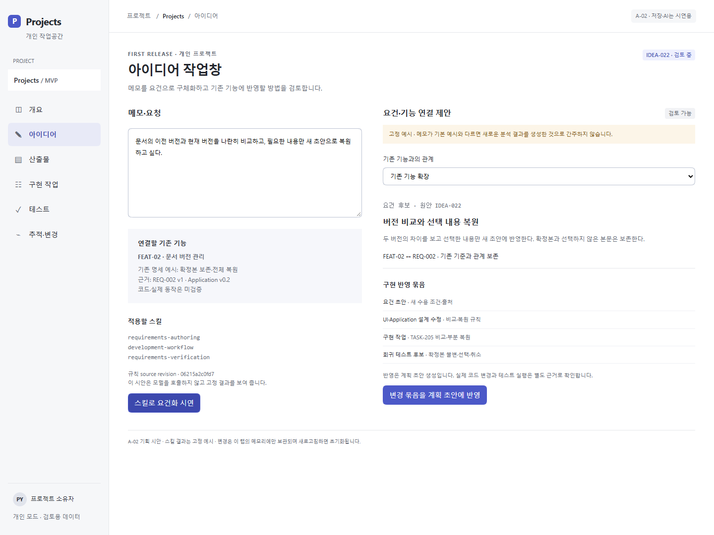
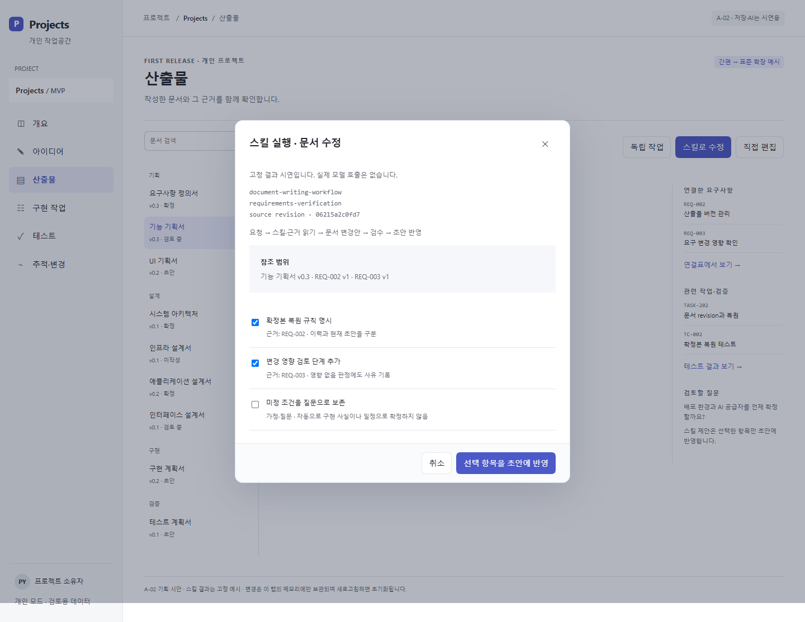

# Projects 기획 초안 v0.3

작성일: 2026-10-21 · 상태: 사용자 검토 전 · 작업명: Projects

이 문서는 초기 기획·조사 기록입니다. 이후 PostgreSQL, Codex 기본 로그인,
Note 연계에 앞선 임시 문서 범위로 로컬 앱을 구현했습니다.
[현재 실행 안내](../implementation/README.md)와
[검증 결과](../implementation/verification.md)를 함께 확인합니다.

## 제품 제안

앱의 기본 동작은 skills.pydemia.ai의 스킬을 활용하는 LLM 작업이다. 아이디어 분석·요건화·기존 기능 대조·문서 작성과 수정·구현 계획·검수를 실행하고 그 결과를 프로젝트의 요구사항, 문서, 구현 작업, 테스트 결과에 연결한다. 사용자는 지금 해야 할 일, 해당 작업의 근거 문서, 완료를 입증할 결과를 같은 프로젝트 안에서 확인한다. 요구사항이 바뀌면 연결된 설계·작업·테스트 중 다시 검토할 대상을 확인한다.

기본 흐름은 `아이디어 → 기획 → 설계 → 구현 계획 → 구현 → 테스트 → 릴리즈`다. 앞 단계로 돌아가는 변경과 기능별 병행 작업을 허용한다. 단계별 산출물 목록과 완료 조건은 프로젝트 규모에 맞게 선택한다.

## 확인된 조건

| 구분 | 내용 |
|---|---|
| 사용자 요청 | 기획·설계·계획·구현·테스트 과정 및 산출물 관리 앱 기획 |
| 필수 문서 | 기능 기획, UI 기획, System Architecture, Infra, Application, Interface, 구현 계획 |
| 사용자 선택 | 개인 중심으로 시작하고 소규모 팀으로 확장 |
| 사용자 선택 | AI는 문서·계획 보조부터 제공 |
| 추가 필수 요구 | 메모를 요건화하고 기존 기능과 엮어 구현 반영 |
| 추가 필수 요구 | Hub 스킬 원문을 사용하며 각 문서를 앱 안/밖에서 독립 작성·수정 |
| 추가 필수 요구 | 앱 행동을 스킬을 활용하는 LLM 실행으로 구성 |
| 추가 필수 요구 | Notion 산출물 종류·예시 확인과 누락/접근 불가 참조의 공개 양식 보완; 제품 연결 방식은 설계안으로 구분 |
| 확인한 저장소 | `pydemia/projects`는 조회 시점에 커밋과 파일이 없는 상태 |
| 원안 | Notion의 아이디어 메모와 연결된 프로젝트 문서·문서 가이드 |
| 이번 결과 | 기능·UI·설계 방향·구현 및 테스트 계획과 검토용 HTML 시안 |

## 읽는 순서

1. [기능 기획](01-product-plan.md): 사용 시나리오, MVP, 데이터·상태·완료 규칙
2. [UI·UX](02-ui-ux.md): 화면 구조, 진입·조작·예외 상태, 실제 시안
3. [설계 방향](03-architecture.md): 네 종류 설계서의 경계, 데이터 구조, 주요 API
4. [구현·테스트 계획](04-delivery-and-tests.md): 의존 순서, 작업 단위, 수용 기준
5. [산출물 카탈로그](05-artifact-catalog.md): 프로젝트별 생성·생략·버전·내보내기 규칙
6. [근거와 결정](06-sources-and-decisions.md): 원문 근거, 추천, 미정 사항, 검수 기록
7. [아이디어 처리](07-idea-to-implementation.md): 요건화·기존 기능 대조·구현 반영 묶음
8. [스킬 실행과 독립성](08-skill-runtime-and-portability.md): bundle·실행·앱 밖 문서 작업
9. [요구사항 기준](09-requirements.md): 사용자 요구와 기획 반영 위치
10. [산출물 예시 확인](10-reference-audit.md): 원문 35종과 실제 접근·확인 범위
11. [공개 양식 라이브러리](11-template-reference-library.md): 대체 참조·다운로드·자체 시작 양식
12. [작업공간 벤치마크](12-task-workspace-benchmark.md): Jira·Confluence·ClickUp·To Do·TickTick·Todoist 비교, 간편/정교 보기와 GTD/ABC 기획

## 먼저 구현할 사용 흐름

`아이디어 메모 → 스킬로 요건화 → 기존 기능 대조 → 반영 방식 선택 → 문서·작업·회귀 테스트 변경안 → 스킬 검수 → 허용 범위에 반영 → 구현·검증 근거 연결`

첫 개발부터 스킬 원문을 resolve하는 LLM 문서 작업을 포함한다. 문서 한 개 작성·수정·검수와 외부 작업 결과의 재연결을 먼저 완주하고, 아이디어→요건→기존 기능→구현 반영으로 확장한다. GitHub 자동 동기화와 팀 협업은 후속 범위다.

산출물 35종의 양식·예시 조사도 구현 계획에 연결한다. 유형·참조 registry, 양식 선택·접근 실패 처리, 스킬 실행과 앱 밖 작업에 같은 참조 manifest 전달을 DEV-R1~R3로 나누고 AC-25~29로 검증한다. 현재는 계획 반영 상태이며 실행 기능은 미구현이다.

## 검토용 화면

[화면 시안 열기](prototype/index.html) · [아이디어 요건화](prototype/screenshots/idea.png) · [스킬 실행](prototype/screenshots/skill-run.png) · [모바일](prototype/screenshots/mobile.png)

모든 수치·상태·문서 본문은 시연용이다. 시안의 AI 제안도 고정 예시이며 모델을 호출하지 않는다. 서버 저장, 인증, 파일 업로드, 실제 GitHub 연동은 구현 범위에 포함되지 않는다.
